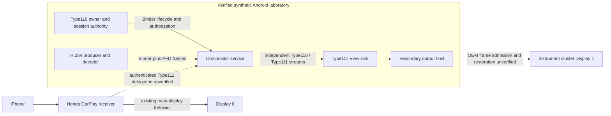

# ClarityLink

[](https://github.com/bmreyes25/ClarityLink/actions/workflows/ci.yml)

ClarityLink is an independent automotive software research and Android integration project. It investigates how an existing main CarPlay display could remain undisturbed while navigation video is rendered on a separate secondary display.

The target under study is a 2018 Honda Clarity PHEV Touring (MY16ADA). Genuine Honda receiver integration and instrument-cluster video output have **not** been established. The Android work described here runs in a synthetic laboratory environment; it does not demonstrate a working vehicle modification.

## Engineering problem

The project explores two distinct boundaries: preserving the existing Type110/main-display experience while managing an independent Type111/secondary video stream, and identifying whether the OEM receiver and instrument cluster expose supported, authorized interfaces for that stream. The laboratory can test the first boundary. The required Honda contracts for the second remain unknown.

ClarityLink is not affiliated with Honda, Apple, or another manufacturer.

## What has been built

The API17 laboratory prototype exercises Android 4.2.2 process and Binder behavior, actual H.264 `MediaCodec` decoding, Binder/PFD frame delivery, concurrent Type110 and Type111 streams, per-session ownership, per-stream generation fencing, stale-frame rejection, View and producer process-death recovery, warning-gated withdrawal and restoration, and a secondary output host. CL-R7 passed both API17 setup orders (Type110-first and Type111-first), with decoded-pixel verification, warning withdrawal/restoration, View-process death and reattachment, Type110 continuity, and cleanup. The final CL-R4 campaign reran that demonstration on the same candidate source.

CL-R4 reliability acceptance is **API17 laboratory PASS**. On source fingerprint `90fabf6d8a31c69a82b4c23fcc00d4823ed399f321e06e262a9b0530883552c3` and APK SHA-256 `fd5b20b4e281424f6880ebc48acd9483ba094d13dec6e57a44c1e006a355beac`, all 12 required cases and all 12 priority combinations passed, including queue saturation with process death/teardown, delayed callbacks, owner/child cleanup, decoder shutdown during delivery, multiple View replacements, registration/replay security, crash recovery, and aggregate resource cleanup. The machine-readable checkpoint and detailed evidence are preserved locally under ignored `build/cl-r4-acceptance-20261019-234709-22337/`; generated emulator evidence is not published in the repository.

## Architecture



Solid links inside the lab show synthetic components that have been exercised on the emulator. Dashed links show the unverified OEM boundaries. The architecture does not claim that the laboratory receiver or output host connects to Honda hardware.

## Verified milestones

| Milestone | Current result | Scope |
|---|---|---|
| CL-R1 through CL-R3 | Lab PASS | Warning preemption, API17 isolation, and Binder-to-View rendering. |
| CL-R4 | API17 laboratory PASS | All 12 required cases and 12 priority combinations passed on one source fingerprint/APK; see the local acceptance manifest noted above. |
| CL-R5 / CL-R6 | Synthetic lab model | Honda authentication delegation and OEM Display 1 frame admission are unproven. |
| CL-R7 | API17 laboratory PASS | Both setup orders, H.264 pixel checks, warning withdrawal/recovery, Type110 continuity, View reattachment, and cleanup passed after the CL-R4 fixes. This is not hardware validation. |
| Honda vehicle validation | Not started | Requires supported OEM contracts, separate authorization, and independent safety review. |

See the [current evidence and status](docs/status/current.md), [open blockers](docs/status/blockers.md), and the [legacy CL-R0–CL-R8 milestone manifest](docs/status/milestones.json). Historical reports remain available under `research/` and `step-reports/`.

The cross-campaign objective and gated path to any Honda integration are in the [CL-MASTER-01 program roadmap](docs/roadmap/claritylink-master-plan.md), with a [finish-line contract](docs/roadmap/finish-line-definition.md), [dependency graph](docs/roadmap/master-dependency-graph.md), and [evidence ledger](docs/status/evidence-ledger.md). Current integration readiness remains NO-GO because supported Honda receiver and Display 1 contracts are not established.

## Quickstart

Run the synthetic visual twin locally; it does not connect to a phone, receiver, or vehicle:

```sh
python3 src/claritylink-sim/export_visual_demo.py --screenstream-h264
python3 -m http.server 8000 --bind 127.0.0.1 --directory demo/type111
```

Open `http://localhost:8000` and choose **Hypothetical Type111**. For the configured offline test suite, install `requirements-test.txt`, install Node.js, then run:

```sh
PYTHON=.venv/bin/python ./tools/run_tests.sh
```

API17 emulator builds and tests are macOS-specific and use the project-pinned Android toolchain. The canonical resumable runner is:

```sh
python3 tools/run_cl_r4_acceptance.py
```

It starts an owned API17 emulator and isolated ADB server, fingerprints the source and APK, and writes a resumable manifest plus evidence under ignored `build/` output. Read [development setup](docs/getting-started/development-setup.md), [testing instructions](docs/development/testing.md), and [tools](tools/README.md) before running it. Host tests do not establish API17 results.

## Repository guide

- [Project overview](docs/getting-started/overview.md), [architecture](docs/architecture/overview.md), and [glossary](docs/glossary.md)
- [Android and Python source](src/README.md), [contribution guidance](CONTRIBUTING.md), and [test instructions](docs/development/testing.md)
- [Current status](docs/status/current.md), [blockers](docs/status/blockers.md), and [safety guidance](docs/safety/vehicle-testing.md)
- [CL-MASTER-01 roadmap](docs/roadmap/claritylink-master-plan.md), [integration readiness](docs/status/integration-readiness.md), and [campaign gates](docs/roadmap/milestone-acceptance-gates.md)
- [Research and evidence classification](research/README.md), [evidence index](EVIDENCE_INDEX.md), and [milestone reports](step-reports/README.md)

## Safety, evidence, and license

`safeForHonda()` remains unconditionally `false`; production Honda integration is disabled. No vehicle, Honda ADB, Honda APK, firmware, instrument-cluster framebuffer, or live iPhone testing is part of this lab result. Do not infer physical compatibility from emulator evidence.

The repository has **no selected license**. The owner must choose one; do not assume public reuse permission. See the [license decision](docs/project/license-decision.md). Do not publish private firmware, vehicle captures, credentials, signing material, or personal information.
