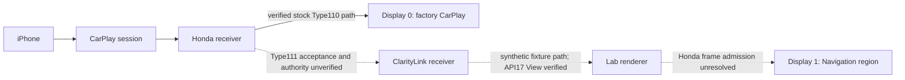

# ClarityLink

[](https://github.com/bmreyes25/ClarityLink/actions/workflows/ci.yml)

ClarityLink is an experimental automotive software research project exploring whether factory CarPlay can remain on a 2018 Honda Clarity's center display while independent navigation uses the instrument cluster's existing Navigation region. This vehicle feature is not implemented, validated, or authorized for installation.

## Project goal

- Preserve factory CarPlay and warnings on Display 0.
- Investigate independent navigation on Display 1.
- Keep factory authentication, audio, controls, instruments, and stock behavior intact.

ClarityLink is not affiliated with Honda, Apple, Tesla, or another manufacturer.

## Current status

The laboratory Binder-to-View path is verified on an isolated API17 emulator. CL-R1 through CL-R3 have laboratory passes. CL-R4 remains partial: dual-stream routing, bounded Type111 delivery, producer death/restart, and Type111 sink death have runtime evidence, while sink reconnection, Type110-only recovery ownership, parent-authority death, and reentrant teardown still need validation. CL-R5 is a synthetic laboratory control-plane model. Genuine authenticated Honda Type111 delegation and a supported Honda frame-output interface remain unestablished. `safeForHonda()` remains false.

See [authoritative current status](docs/status/current.md), [blockers](docs/status/blockers.md), and the [roadmap](docs/roadmap/final-development-plan.md) for evidence and next steps. API17 results describe emulator behavior only; they do not establish Honda compatibility or vehicle readiness.

## Architecture



Solid Type110 represents the examined stock path. The Type111 fixture-to-View path is verified in the API17 laboratory; dashed links mark unresolved receiver authority and Honda-owned output interfaces. The diagram does not describe a working vehicle modification.

## Offline quickstart

The visual twin uses synthetic data and does not connect to a phone or vehicle.

```sh
python3 src/claritylink-sim/export_visual_demo.py --screenstream-h264
python3 -m http.server 8000 --bind 127.0.0.1 --directory demo/type111
```

Open `http://localhost:8000` and choose **Hypothetical Type111**. See the [full quickstart](docs/getting-started/quickstart.md) and [development setup](docs/getting-started/development-setup.md).

## Documentation

- New readers: [project overview](docs/getting-started/overview.md), [architecture](docs/architecture/overview.md), and [glossary](docs/glossary.md).
- Developers: [contributing](CONTRIBUTING.md), [testing](docs/development/testing.md), [source](src/README.md), and [tools](tools/README.md).
- Current engineering: [status](docs/status/current.md), [capabilities](docs/status/capabilities.md), and [blockers](docs/status/blockers.md).
- Roadmap: [CL-R0–CL-R8 plan](docs/roadmap/final-development-plan.md), [milestone specifications](docs/roadmap/milestone-specifications.md), and [dependencies](docs/roadmap/dependency-map.md).
- Researchers: [research guide](research/README.md), [evidence index](EVIDENCE_INDEX.md), and [historical milestone reports](step-reports/README.md).
- Safety: [vehicle testing](docs/safety/vehicle-testing.md) and [security reporting](SECURITY.md).

## Safety and evidence

Offline and synthetic results do not prove Honda behavior. Vehicle observation, emulator use, live iPhone sessions, installation, and hardware validation require their own gates and, where applicable, separate explicit authorization. Do not publish private vehicle identifiers, credentials, firmware, raw captures, or personal information. See [safety guidance](docs/safety/vehicle-testing.md) and [evidence classifications](docs/development/evidence-classification.md).

## Contributing and license

Start with [contribution instructions](CONTRIBUTING.md). The repository has **no selected license**; do not assume public reuse permission. See the [license decision](docs/project/license-decision.md).
