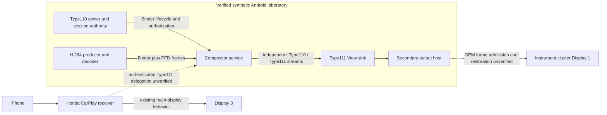

# ClarityLink

[](https://github.com/bmreyes25/ClarityLink/actions/workflows/ci.yml)

ClarityLink is an independent automotive software research and Android integration project. It investigates how an existing main CarPlay display could remain undisturbed while navigation video is rendered on a separate secondary display.

The target under study is a 2018 Honda Clarity PHEV Touring (MY16ADA). Genuine Honda receiver integration and instrument-cluster video output have **not** been established. The Android work described here runs in a synthetic laboratory environment; it does not demonstrate a working vehicle modification.

## Engineering problem

The project explores two distinct boundaries: preserving the existing Type110/main-display experience while managing an independent Type111/secondary video stream, and identifying whether the OEM receiver and instrument cluster expose supported, authorized interfaces for that stream. The laboratory can test the first boundary. The required Honda contracts for the second remain unknown.

ClarityLink is not affiliated with Honda, Apple, or another manufacturer.

## What has been built

The API17 laboratory prototype exercises Android 4.2.2 process and Binder behavior, actual H.264 `MediaCodec` decoding, Binder/PFD frame delivery, concurrent Type110 and Type111 streams, per-session ownership, per-stream generation fencing, stale-frame rejection, View and producer process-death recovery, warning-gated withdrawal and restoration, and a secondary output host. The current CL-R7 candidate passed both setup orders on API17: Type110-first and Type111-first. The rerun covered decoded-pixel verification, warning withdrawal and restoration, actual View-process death and reattachment, Type110 continuity, and cleanup. APK SHA-256: `26a659e5433ea168fb157f2cbae150d792b5ce275c8381f4e883d30f239066fc`. Full local evidence is under the ignored `build/cl-r7-lab-20261019-124248-19895/` directory.

CL-R4 reliability acceptance is still **partial**. The current resumable acceptance runner records each required case separately and refuses an overall PASS while any mandatory case or priority interleaving is unexecuted or failed. On the exact candidate fingerprint `07f43ef7c882f21c5fdb55f6645500eff5beefe3763f5f3b05ac7f2e0c2211ac` and APK SHA-256 `b23ccc5de16e6942b8ee4e55fc84f2d2dbd370b674aaee86bb57c06caa4d9826`, API17 cases CL-R4-06 (delayed callbacks) and CL-R4-12 (saturated-queue View crash recovery) passed; the runner derived priority cases P01 and P07 as PASS. CL-R4-01 passed on an earlier separate candidate. The complete final-source 12-case matrix, remaining priority interleavings, and aggregate cleanup have not passed together.

## Architecture



Solid links inside the lab show synthetic components that have been exercised on the emulator. Dashed links show the unverified OEM boundaries. The architecture does not claim that the laboratory receiver or output host connects to Honda hardware.

## Verified milestones

| Milestone | Current result | Scope |
|---|---|---|
| CL-R1 through CL-R3 | Lab PASS | Warning preemption, API17 isolation, and Binder-to-View rendering. |
| CL-R4 | Partial | Reliability matrix and aggregate cleanup remain open. |
| CL-R5 / CL-R6 | Synthetic lab model | Honda authentication delegation and OEM Display 1 frame admission are unproven. |
| CL-R7 | API17 laboratory PASS | Both setup orders, H.264 pixel checks, warning withdrawal/recovery, Type110 continuity, View reattachment, and cleanup passed on the current candidate APK. This is not hardware validation. |
| Honda vehicle validation | Not started | Requires supported OEM contracts, separate authorization, and independent safety review. |

See the [current evidence and status](docs/status/current.md), [open blockers](docs/status/blockers.md), and the [milestone manifest](docs/status/milestones.json). Historical reports remain available under `research/` and `step-reports/`.

## Quickstart

Run the synthetic visual twin locally; it does not connect to a phone, receiver, or vehicle:

```sh
python3 src/claritylink-sim/export_visual_demo.py --screenstream-h264
python3 -m http.server 8000 --bind 127.0.0.1 --directory demo/type111
```

Open `http://localhost:8000` and choose **Hypothetical Type111**. For the configured offline test suite, install `requirements-test.txt`, install Node.js, then run:

```sh
PYTHON=.venv/bin/python ./tools/run_tests.sh
```

API17 emulator builds and tests are macOS-specific and use the project-pinned Android toolchain. The canonical resumable runner is:

```sh
python3 tools/run_cl_r4_acceptance.py
```

It starts an owned API17 emulator and isolated ADB server, fingerprints the source and APK, and writes a resumable manifest plus evidence under ignored `build/` output. Read [development setup](docs/getting-started/development-setup.md), [testing instructions](docs/development/testing.md), and [tools](tools/README.md) before running it. Host tests do not establish API17 results.

## Repository guide

- [Project overview](docs/getting-started/overview.md), [architecture](docs/architecture/overview.md), and [glossary](docs/glossary.md)
- [Android and Python source](src/README.md), [contribution guidance](CONTRIBUTING.md), and [test instructions](docs/development/testing.md)
- [Current status](docs/status/current.md), [blockers](docs/status/blockers.md), and [safety guidance](docs/safety/vehicle-testing.md)
- [Research and evidence classification](research/README.md), [evidence index](EVIDENCE_INDEX.md), and [milestone reports](step-reports/README.md)

## Safety, evidence, and license

`safeForHonda()` remains unconditionally `false`; production Honda integration is disabled. No vehicle, Honda ADB, Honda APK, firmware, instrument-cluster framebuffer, or live iPhone testing is part of this lab result. Do not infer physical compatibility from emulator evidence.

The repository has **no selected license**. The owner must choose one; do not assume public reuse permission. See the [license decision](docs/project/license-decision.md). Do not publish private firmware, vehicle captures, credentials, signing material, or personal information.
