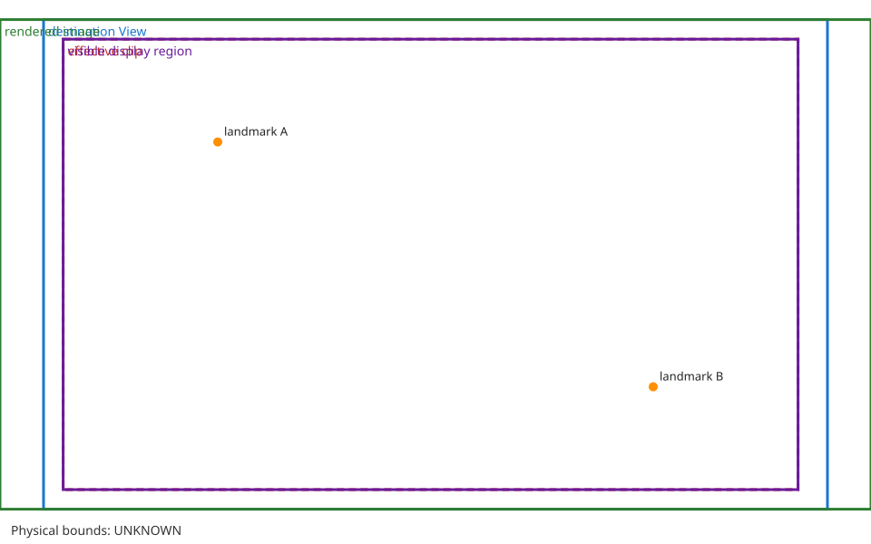

# CL-HH-02 — Display 1 rendering-boundary status

## Publication-safe conclusion

HondaHack's public documentation describes Screen Casting and instrument-cluster features, but does not document a caller-authorized frame-input API for ClarityLink. Therefore this work does not establish a supported Honda Display 1 frame-admission interface. `safeForHonda()` remains false, and no Honda adapter is enabled.

This report is limited to public documentation and the generic synthetic geometry model below. It does not claim that the model reflects a vehicle implementation.

## Public synthetic geometry model

`src/claritylink-renderer/display_geometry.py` is a generic, independently authored coordinate model. It accepts an explicit source size, destination View rectangle, scaling policy, optional clipping rectangle, optional landmarks, and an optional projective transform from display coordinates into calibrated photo coordinates. It does not define Honda-specific defaults, create a display, grant output authority, or imply physical visibility.

The model reports `physical_visible_bounds` as unknown. A photo transform can map known landmarks into the photo coordinate space; it cannot establish a safe region without independently measured aperture boundaries and calibrated observations.

No physical aperture boundary or warning-preemption contract is established here. Physical bounds and warning behavior remain unknown.

## Tests and scope

`tests/renderer/test_cl_hh_02_geometry.py` exercises exact sizing, aspect-ratio scaling, crop, clipping, offsets, landmarks, optional photo calibration, invalid geometry, and the explicit unknown physical-bound state. The SVG fixture is synthetic and uses arbitrary generic dimensions; it is not a vehicle image or a Honda safe-area illustration.

These tests validate arithmetic and fail-closed handling only. They do not establish HondaHack compatibility, OEM authorization, physical cluster geometry, warning priority, restoration, or vehicle safety.

## Exact remaining gap

Two different evidence packages are needed to change the conclusion:

1. A synchronized Display 1 frame and camera observation with calibrated landmarks plus the relevant rendering configuration can estimate the visible mapping for that observed setup. That estimate alone is not an OEM safe-area guarantee.
2. An OEM/Honda-authorized integration specification or supported sample must define caller authorization, the accepted frame/surface contract, geometry, warning preemption, withdrawal, and restoration. Private reverse-engineering evidence does not substitute for that contract.

No physical test is authorized by this offline investigation. No Honda operation, APK installation/execution/modification, firmware write, framebuffer operation, live CarPlay experiment, warning modification, or cluster takeover occurred.
