# CL-R9E — genuine Honda Type111 integration readiness

## Decision

**No end-to-end supported Honda integration is established.** The reviewed Honda receiver path does not negotiate the secondary-display feature set or dispatch Type111 in the examined static paths; the Honda display path has no supported third-party frame-admission contract in the reviewed evidence. No Honda adapter is enabled. `safeForHonda()` remains false.

This report consolidates [CL-R9A](cl-r9a-control-setup-comparison.md) and [CL-R9B](cl-r9b-type111-session-handoff.md), plus [CL-R9C PR #43](https://github.com/bmreyes25/ClarityLink/pull/43) and [CL-R9D PR #44](https://github.com/bmreyes25/ClarityLink/pull/44). It uses the published, bounded summaries and their existing static evidence scope; it does not repeat Honda artifact extraction or publish new private vehicle data. Audi source behavior and author-reported iOS reverse-engineering remain reference-only and are not promoted to Honda contracts.

## Canonical pipeline and boundary status

Classification is scoped to the named boundary. `VERIFIED` applies only to independently exercised ClarityLink lab behavior; it never means Honda-compatible. `SUPPORTED_BUT_UNTESTED` means a documented applicable Honda/OEM contract exists but has not been executed. `STATIC_EVIDENCE` means a bounded Honda implementation path was examined but no support promise follows. `SYNTHETIC_LAB_ONLY` means only model/lab authority exists. `UNKNOWN` is unresolved. `UNSUPPORTED` means the reviewed interface/path does not provide a supported extension for that function, not that no future Honda contract could exist.

```mermaid
flowchart LR
  I[iPhone CarPlay sender] -->|control/session; target Type111 request unknown| A[Honda authenticated session owner]
  A -->|/info secondary-display negotiation: no contract found| N[Capability agreement]
  N -->|Type111 SETUP dispatch: skipped in reviewed path| S[Authorized stream creation]
  S -->|transport/security handle: no delegate found| T[Type111 media transport]
  T -->|existing lab-only receiver path| D[ClarityLink H.264 decoder]
  D -->|existing lab Binder/PFD path| F[CL-R6 warning-gated output host]
  F -->|Honda caller authorization/frame sink: unknown| H[Honda Display 1 owner]
  H -->|physical Navigation viewport and restoration: unknown| C[Instrument cluster Navigation region]
```

| Pipeline boundary | Status | Evidence and consequence |
|---|---|---|
| Phone offers a secondary display to this Honda and requests Type111 | `UNKNOWN` | Audi authors report version-specific iOS behavior; it is not a guarantee for every phone. No authorized Honda/target-phone transaction establishes this offer. |
| Honda authenticated session owner | `STATIC_EVIDENCE` | Honda's inspected receiver owns its factory session/authentication state for its existing streams. No authorized session-delegate contract to ClarityLink was found. Preserve factory ownership. |
| Honda `/info` secondary-display advertisement and feature agreement | `UNSUPPORTED` in the reviewed path | CL-R9A recovered one main display descriptor and no supported construction/consumption of the secondary advertisement or accepted feature set. This is bounded to examined paths. |
| Honda Type111 SETUP admission and response | `UNSUPPORTED` in the reviewed path | CL-R9B found Type110 handling and Type111 skip/log behavior; no Type111 response/port branch was established. A parseable request is not authorization. |
| Honda-authorized Type111 stream identity, transport and security context | `UNKNOWN` | No receiver-owned Type111 handle, approved stream-connection binding, transport-security metadata, VideoConfig lifecycle, or teardown delegation was found. Honda auth material must remain with its legitimate owner. |
| ClarityLink H.264 decode and frame generation | `VERIFIED` in lab only | CL-R7 tests decode generated H.264 media and produce decoded PNG frames in the synthetic receiver. Not Honda ciphertext, framing, VideoConfig, or session input. |
| Binder/PFD frame delivery and CL-R6 output lifecycle | `VERIFIED` in lab only | Existing CL-R6/CL-R7 lab host exercises ownership, generation, failure, and teardown. It is not a Honda Display 1 admission contract. |
| Honda warning-aware frame admission into Display 1 | `UNSUPPORTED` as a ClarityLink interface; Honda behavior `UNKNOWN` | CL-R9C found no supported caller-authorized frame sink. Existing host/view ownership and generic Android APIs do not authorize a caller or prove warning ordering. |
| Physical cluster Navigation region, warning preemption and factory restoration | `UNKNOWN` | The logical Display 1 canvas is not the physical map viewport. No supported safe-area, warning-preemption, withdrawal, or restore contract was established. |

There is no `SUPPORTED_BUT_UNTESTED` Honda stage: the missing facts are contract and authorization gaps, not merely a lack of a test run.

## Consolidated R9 findings

| Milestone | Result | Evidence boundary |
|---|---|---|
| R9A — `/info` and control-SETUP | No known Honda secondary negotiation contract. The recovered path advertises one main display; `extendedFeatures` and a negotiated `enabledFeatures` contract are not established. | Honda conclusions are bounded static evidence. Audi's `AirPlayCopyServerInfo`/SETUP seam is Audi-only; its iOS activation sequence includes author-reported reverse engineering. |
| R9B — Type111 SETUP and authenticated delegation | No supported Honda Type111 branch or receiver-to-consumer handoff is established. The factory session security owner remains Honda-controlled. | Static Honda path shows Type110 and unsupported Type111 dispatch behavior; ClarityLink delegation tests use explicit mock ownership only. |
| R9C — Navigation and Display 1 | Honda owns the reviewed Android display/view path. No supported external frame admission, safe physical viewport, warning priority, or restoration interface was found. | Static display source and prior read-only observations; downstream physical composition remains unknown. |
| R9D — HondaHack | Public feature claims include Screen Casting, Advanced Meter and Waze guidance. The HondaHack documentation reviewed does not specify a third-party frame API. | Public docs establish product claims and Clarity Advanced Information scope; they do not specify an OEM frame API. |

The Audi project demonstrates one target-specific architecture for receiver negotiation, Type111 media ownership, and managed output. Its hooks, session/security assumptions, QNX Screen APIs, display contexts, and author-reported phone observations do not establish Honda behavior. No GPL implementation was copied.

## Architecture options

| Option | Established components | Permissions / authority needed | Type110 preservation | Genuine Type111 status | Display/output requirements | Feasibility without factory modification |
|---|---|---|---|---|---|---|
| **A. Additive extension of Honda's receiver** | Factory Type110/auth owner is present; ClarityLink's lab Type111 receiver and output host are tested. | Honda must document and authorize a child Type111 stream delegate while retaining its session/auth context, plus define secure transport metadata and lifecycle. | Best architectural fit: factory remains owner of Type110/audio/control; secondary resources are child-scoped. This is a design property, not a verified Honda contract. | Not currently implementable: no negotiation, SETUP, stream handoff, or authorization API verified. | Still requires Honda-owned frame sink, geometry, warning priority, withdrawal and restoration. | **No** on current evidence; not without a supported receiver extension. |
| **B. Independent receiver with its own authority** | ClarityLink has a synthetic receiver/decoder and lab outputs. Existing R6 research establishes no configured legitimate MFi authority for the target integration. | Its own genuine authorized CarPlay/MFi authentication authority and supported transport; no shared/recovered credentials or bypass. | It need not modify the factory Type110 implementation, but simultaneous phone session/coexistence is unknown and cannot be assumed. | Technically relevant as a separate receiver architecture, but genuine target Type111 is not established by lab profiles. | Same Honda Display 1 admission and warning contract is still required. | **Not currently**; technically possible only if authentication, phone concurrency, and display admission are separately supported. |
| **C. Honda Navigation or screen-presentation API** | Honda semantic Navigation/TBT services and HondaHack feature claims exist. | OEM-documented caller authorization and accepted data/frame schema required. | Could preserve Type110 if it is a documented additive presentation API. No such contract found. | Semantic route/TBT is not independent H.264. HondaHack's public Screen Casting claim does not document Type111 or a third-party frame sink. | Needs legal geometry, warning preemption, owner lifecycle and factory restoration. | **No** verified API; only a future documented OEM/HondaHack consumer contract could change this. |
| **D. Alternative supported secondary-display transport** | Generic Android `Presentation` and Audi/QNX examples are known platform/prior-art candidates. | Honda app signing/permissions/display admission or a documented OEM transport grant required. Audi privileges are target-specific. | Unknown. | No source-backed Honda Type111 connection follows from these display mechanisms. | Warning order, physical viewport, disconnect and restoration remain unknown. | **No** supported Honda transport established. |

No option is preferred merely because a synthetic test accepts it. A vehicle-usable path requires both a genuine, authorized Type111 stream and protected Honda cluster presentation.

## Disabled boundary and cross-boundary tests

No verified Honda receiver or display contract justified an enabled adapter. The Honda Type110 static adapter remains Type110-only and rejects Type111. `HondaHackFrameAdmissionGate` is diagnostic only and always raises `EvidenceRequired`; it is not enforcement attached to a production renderer. Synthetic authority or capability fixtures cannot open either boundary.

The new [CL-R9E cross-boundary test](../../tests/integration/test_cl_r9e_cross_boundary_contract.py) uses the existing CL-R7 receiver with explicit `MODEL_ONLY` authority, both Type110/Type111 setup orders, generated H.264 input, and local NullDisplay outputs. It demonstrates that synthetic decode can work while the Honda static Type110 adapter and Honda output gate still reject integration. It does not claim Honda compatibility.

| Requirement | Existing test coverage (synthetic/lab scope) |
|---|---|
| Secondary capability consistency, identity uniqueness, feature agreement, absent `enabledFeatures`, malformed metadata, incomplete readiness | `tests/integration/test_cl_r9a_contract_fixtures.py` |
| Honda Type111 rejection, mock receiver authority, wrong session/generation, stream identity, duplicate setup, missing transport setup, Type110 preservation, parent teardown/resource cleanup | `tests/jmcs/test_cl_imp_06_stock_delegation.py`, `tests/jmcs/test_r5h_honda_boundary.py` |
| Type110-first and Type111-first lab setup, H.264 decode, frame identity/generation, Type110 continuity, secondary-only teardown and lab resource cleanup | `tests/jmcs/test_r7a_integrated_dual_receiver.py`, `tests/integration/test_cl_r9e_cross_boundary_contract.py` |
| Native receiver contract | `tests/jmcs/test_r7b_native_conformance.py` (environment-dependent; report skips explicitly) |
| Warning priority/preemption model and loss/recovery | `tests/renderer/test_test4b_cluster_priority_model.py`, `tests/renderer/test_test4c_preemption_model.py` |
| View close/death and CL-R4 fault behavior | `tests/display/test_cl_r4b_view_close_contract.py`, `tests/display/test_cl_r4b_fault_acceptance_contract.py` |
| Decoder/replay/lifecycle/resource faults | R5Y fixtures and `tests/sandbox/test_r5y_replay_and_boundary.py`, `tests/transport/test_type111_lifecycle_twin.py` |

All these tests validate ClarityLink models and lab code only. They cannot establish Honda receiver authorization, Type111 compatibility, physical pixels, warning preemption, or vehicle safety. No Android production/runtime code changed in CL-R9E. The API-17 Java policy/lifecycle regression script is run, but no new emulator run or APK rebuild is claimed. Existing CL-R7 emulator evidence remains tied to its recorded source/APK hashes, not this integration.

CL-R9E validation: the focused cross-boundary, R9A, CL-IMP-06, R5H, R7A/R7B, receiver, Type111 lifecycle, affected CL-R4 view/fault, warning, and replay set passed **257 tests, 1 skipped**. The configured offline suite passed **1,321 tests, 29 skipped**, followed by all 3 self-locator smoke checks, simulator JavaScript checks, and Git whitespace validation. The API-17 Java policy/process, host lifecycle, YUV/frame, compositor, dispatch, and warning-race checks passed using the configured JDK 17 and Android API-17 SDK. No Honda or phone operation occurred. Skips are environment/fixture gated and are not Honda evidence.

## Remaining contract and next decisive step

The single highest-value next action is an **authorized written Honda/MY16ADA integration specification or supported sample** answering both halves of one end-to-end contract:

1. Which `/info` secondary-display fields and control-SETUP proposal does this factory receiver support, and who owns the accepted `enabledFeatures` set?
2. Does the legitimate receiver accept Type111, and what versioned interface authorizes a consumer with exact session, stream connection ID, generation, transport/security metadata, VideoConfig, and withdrawal/teardown semantics while retaining Honda's authentication context?
3. Which Honda-owned service admits decoded frames into the factory Navigation region, with caller permission, legal geometry, warning preemption, owner-loss, and guaranteed restoration?

Until that evidence exists, do not perform an active vehicle experiment. Any future bench experiment needs its own authorization and review procedure derived from the actual API contract. A string match, Audi precedent, HondaHack feature claim, generic Android window API, or successful synthetic test cannot close these gaps.

## Publication and safety state

R9A and R9B are merged; R9C and R9D are open PRs at consolidation time. No private Honda research is added by this report. `safeForHonda()` remains false. No Honda ADB, Honda APK install, firmware/binary edit, direct framebuffer operation, credential extraction, unauthorized phone session, or cluster takeover occurred.
