# Roadmap dependencies

```mermaid
flowchart LR
  R0[CL-R0 repository foundation] --> R1[CL-R1 warning race]
  R1 --> R2[CL-R2 emulator isolation]
  R2 --> R3[CL-R3 Binder-to-View]
  R3 --> R4[CL-R4 Type111 fixture-to-View]
  R4 --> R5[CL-R5 authenticated extension contract]
  R5 --> R6[CL-R6 Honda integration contract]
  R6 --> R7[CL-R7 authorized hardware validation]
  R7 --> R8[CL-R8 integrated navigation]
```

The sequence describes necessary gates, not proof that each gate will be reachable. CL-R5 may require a separate evidence path; CL-R6–CL-R8 remain blocked without supported Honda interfaces and distinct authorization.
