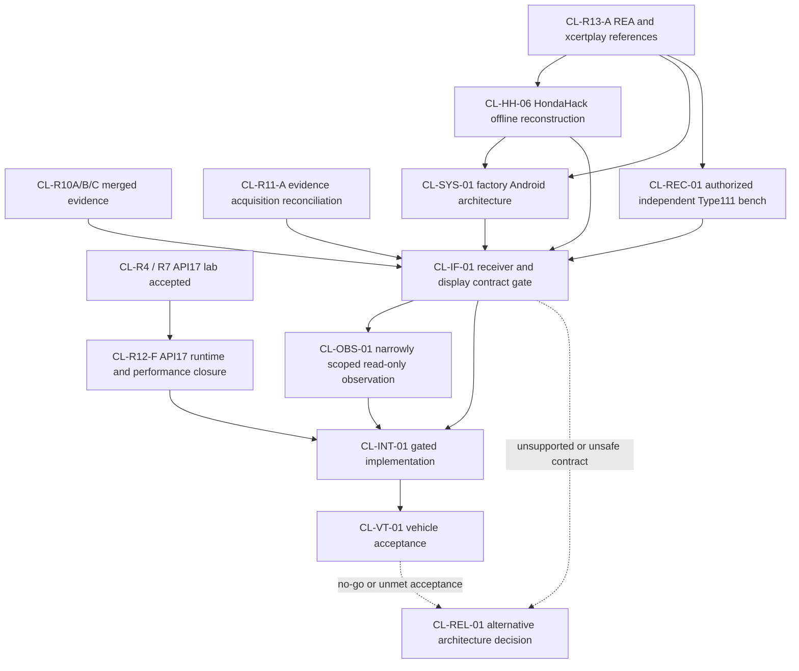

# CL-MASTER-01 dependency graph

Dashed edges mark a possible no-go path, not permission to conduct an experiment. `CL-OBS-01` only begins after a specific question, independent review, fixed read allowlist, and separate explicit owner approval. `CL-INT-01` and `CL-VT-01` remain disabled until their gates pass. Keep `safeForHonda() == false`.

## Gate order

1. Reconcile public and private evidence without importing unpublished commits into this roadmap.
2. Close offline reference and system reconstruction work.
3. Restore reproducible API17 runtime and establish measurable lab performance.
4. If separately approved, prove a genuine Type111 stream on an independent bench receiver; this does not prove Honda compatibility.
5. Establish both Honda receiver and cluster contracts from authorized sources. Either unresolved contract keeps Honda integration NO-GO.
6. Consider only the minimum read-only target observation needed to answer a named unresolved question and only after its separate review and approval.
7. Implement offline against approved interface contracts; then separately review and authorize any vehicle test.
8. If the target contract is unavailable, complete CL-REL-01 and report the original finish line as unachieved.
