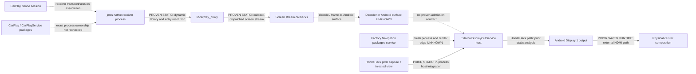

# CL-SYS-01A — factory Android architecture and boundaries

**Verdict: C — previous findings confirmed, with a reproducible receiver-side static check. NO-GO remains.** The preserved factory archive contains the relevant receiver, Navigation, ExternalDisplay, framework, and native artifacts. Current REA/Ghidra analysis reproduced the native `jmcs` → CarPlay proxy boundary. The live REA Android/JADX provider was unavailable, so this report does not claim a fresh APK manifest, Java service graph, or JNI audit. `safeForHonda() == false`.

## Scope and provenance

This is bounded static analysis of a preserved API17-era, 32-bit ARM system/vendor artifact set and prior sanitized HondaHack research. The selected components were listed in the preserved archive and copied by named archive entry into authorized private storage; no source image or APK was modified or executed. The archive hash matched its retained checksum record, and the archive verification error file was empty. The preservation note does not certify that all partitions were contemporaneous or that the backup procedure was complete. Exact component hashes, local paths, REA Evidence IDs, and raw outputs remain private.

Evidence labels in this report mean **PROVEN STATIC** for the current inspected artifact or cited prior static record, **PRIOR SAVED RUNTIME** for historical snapshots only, **INFERRED** for a bounded interpretation, and **UNKNOWN** where the available evidence does not resolve the boundary.

### Tool readiness for this campaign

- **REA native analysis:** available. Ghidra 12.1.4 through REA opened the preserved ARM `jmcs` and CarPlay proxy binaries and returned current evidence.
- **REA Android/JADX:** unavailable in the running Codex MCP. Five live package-inspection calls failed because the configured JADX headless provider path was absent. No provider was installed or downloaded. Prior CL-HH-06 REA/JADX results remain valid for that HondaHack artifact, but do not establish current factory APK analysis.
- The preserved archive inventory includes the Android packages and paired optimized DEX files, the external-display library and optimized DEX, framework archives, the display binary, and display/binder runtime libraries. Their current manifests and Java call graphs still need a successful, supported JADX analysis.

## Bounded artifact inventory

| Component family | Preserved items | What this pass establishes |
|---|---|---|
| CarPlay receiver applications | CarPlay and CarPlayService APKs and paired ODEX files | Presence in the preserved system/vendor archive. Current component declarations and app-to-process edges are **UNKNOWN**. |
| Navigation | Navigation APK and paired ODEX file | Presence. Fresh activity/service and process relationships are **UNKNOWN**. |
| External display | ExternalDisplayApService and ExternalDisplayOutService APK/ODEX pairs; ExternalDisplayLib JAR/ODEX | Presence. The HondaHack report independently identifies the output host process as the view-insertion destination; this does not make it a public or supported extension point. |
| Native receiver and Android display | `jmcs`, `libcarplay_proxy`, surfaceflinger, libgui, libui, libbinder, libandroid_runtime, libsurfaceflinger | Current Ghidra inspection covered `jmcs` and `libcarplay_proxy`; the remaining libraries were inventoried but not analyzed. |
| Framework service metadata | framework.jar, services.jar, android.policy.jar | Presence only. No framework/service implementation conclusions are newly claimed. |

The preserved inventory is sufficient to identify the bounded next static targets. It is not a substitute for a build-matched, complete Android framework and application graph.

## Process and service map

The arrows between `jmcs` and its native CarPlay proxy are established by direct static inspection of the preserved artifacts. The inner proxy exposes separate authentication, audio, and screen-stream callback families. The screen registration table is singleton within the inspected proxy: a duplicate registration is rejected, and unregister clears that table. This is an internal receiver callback boundary; it does not show a second-screen descriptor, Type111 negotiation, caller authorization, or a cross-process frame-to-display interface.

The diagram deliberately leaves the receiver-to-Display-1 edge absent. The current evidence does not connect the `jmcs` screen callback stream to an Android decoder or to the ExternalDisplay host. The selected APKs and Android framework files could answer additional static questions after JADX is available.

## Display pipeline and ownership

The CL-HH-06 report identifies HondaHack's screen-cast path as Display 0 screenshot pixels copied into a shared-memory buffer, consumed into an app bitmap, then placed in a HondaHack view inserted in-process into the Honda external-display host. Historical Display 1 captures show the Android external output at 800×480. These establish a private implementation route and a logical Android display output; they do not establish an OEM renderer API or the physical Navigation aperture.

| Boundary | Evidence class | Conclusion and limit |
|---|---|---|
| HondaHack view insertion into the ExternalDisplay host | PROVEN STATIC in CL-HH-06 | Requires code running inside the Honda-owned host process for the observed route. This is not caller authorization or a supported external API. |
| Android Display 1 logical output | PRIOR SAVED RUNTIME | 800×480 external-display output was observed historically. This does not identify downstream crop, mask, scaling, or panel ownership. |
| Physical Navigation viewport | UNKNOWN | No physical bounds or safe rectangle follows from the Android display size or HondaHack layout. |
| Display host ownership | PROVEN STATIC in prior bounded host research; corroborated by CL-HH-06 | Honda owns the host hierarchy; app-supplied content in that hierarchy does not create a lease or delegated ownership contract. |
| Factory Navigation/CarPlay app-to-host Binder graph | UNKNOWN in this pass | No new class-level analysis was possible with the unavailable Android provider. Do not infer a Binder view/frame endpoint from package presence or service names. |

**No documented Navigation frame-admission interface is established.** `ExternalDisplayOutService` being a package/component or display host is not proof that an ordinary external caller may submit pixels or a `Surface`. The prior CL-HH report's observed Xposed insertion remains a private in-process implementation detail.

### Feature data-source matrix

| Feature | Data form | Renderer / consumer | Evidence and boundary |
|---|---|---|---|
| Screen casting | Display 0 pixels represented as bitmap frames | HondaHack ImageView inside injected content in the Honda external-display host | **PROVEN STATIC** by CL-HH-06. This is the private pixel route; no CarPlay receiver callback feeds it. |
| Factory Navigation | Honda-owned navigation state and content | Factory Honda Navigation / display services | Packages are inventoried. Exact process and renderer data flow was not freshly decoded; **UNKNOWN** here. |
| Waze turn-by-turn | Would be semantic maneuver/guidance data if a producer exists | No HondaHack in-app Waze producer was established in CL-HH-06; generic route/service interface remains unclassified | **UNKNOWN**. Semantic guidance is not arbitrary video-frame admission. |
| Advanced Meter | Structured instrument/navigation values and widget inputs | HondaHack custom Android views in the same host integration | **PROVEN STATIC** in CL-HH-06 as a widget path, separate from bitmap casting. Downstream data-service effects remain unknown. |

These categories are not interchangeable: a pixel source, semantic navigation producer, vehicle-data consumer, Android view renderer, and Honda service client require separate evidence and authority.

## Receiver pipeline and xcertplay comparison

| Contract stage | Preserved Honda evidence | xcertplay public-source comparison |
|---|---|---|
| Receiver-side native boundary | **PROVEN STATIC:** `jmcs` resolves authentication, audio, and screen-stream entry families from the CarPlay proxy. | xcertplay implements its own Android receiver and stream lifecycle. Its implementation is not Honda firmware evidence. |
| Alternate display advertisement / Type111 | **UNKNOWN / unsupported by this artifact pass:** no fresh Honda APK or protocol-path inspection; prior Honda research has not established supported Type111 handoff. | At pinned source commit `1298fb35e29ee30e7bd849cb0e751b52aa22a13f`, xcertplay models an alternate descriptor and gates stream setup on its alternate-screen negotiation path. These are xcertplay-specific behaviors. |
| Stream identity and video ownership | The proxy's screen callback family alone does not identify phone session, display role, Type111 stream, or output destination. | xcertplay source associates stream handling with session and stream type, then routes media to its sink/viewer path. |
| Decoder / output | No proven `jmcs` stream-to-Android `Surface` or Display 1 edge. | xcertplay can decode or forward frames to its own output components; its browser-based cluster view is not a Honda renderer contract. |
| Teardown | Proxy exposes normal screen callback stop/finalize and unregister paths. That does not prove recovery after process death. | xcertplay has explicit source teardown paths; implementation behavior does not establish Honda's host restoration policy. |

Source comparison is pinned to the public [`shilapi/xcertplay` source commit](https://github.com/shilapi/xcertplay/tree/1298fb35e29ee30e7bd849cb0e751b52aa22a13f) and its [alternate-screen descriptor implementation](https://github.com/shilapi/xcertplay/blob/1298fb35e29ee30e7bd849cb0e751b52aa22a13f/shared/src/main/java/com/shilapi/xcertplay/airplay/AirPlayInfoPlist.kt). It is comparative prior art only. It does not prove Honda advertises or accepts Type111.

## Vehicle-interface risk matrix

Classification is for the reviewed boundary only. No interface was invoked.

| Boundary | Classification | Side-effect assessment |
|---|---|---|
| Android display capture / saved SurfaceFlinger observation | OBSERVATIONAL | Reads display state/pixels. It says nothing about other service calls in the app. |
| `jmcs` ↔ CarPlay proxy screen callbacks | UNKNOWN | A media callback path is visible, but the full caller graph and downstream effects were not audited. It does not prove vehicle-bus purity. |
| CarPlay authentication callbacks | MIXED / UNKNOWN | The proxy has challenge/identity/certificate/signature callback families. Ownership and full effects are not established here; no credentials or authentication operation were accessed. |
| Navigation and ExternalDisplay service clients | UNKNOWN | The current Android provider did not decode the relevant implementations. A method name such as “get” is not evidence of no mutation. |
| Vehicle bus effects of a renderer-only client | UNKNOWN | Absence of an invocation or a write in selected code would not establish a bus-free transitive path. |

No vehicle-facing call, private Binder transaction, or bus command was run.

## Warning, lifecycle, and restoration matrix

| Event | What is established | What remains unproven |
|---|---|---|
| Factory Navigation change | Prior HondaHack evidence contains normal page/feature transition paths. | Physical viewport, host-enforced grant/revocation, and restoration timing. |
| Factory warning / interrupt | One historical Door Open example is limited evidence. | Universal warning priority and composition order. |
| User exits feature | Normal callback-based detach/cleanup exists in the HondaHack path. | Completion when callbacks are skipped or a process dies. |
| Producer or consumer dies | Normal protocol close/disconnect paths exist in selected code. | Stale-frame withdrawal and guaranteed host cleanup after abrupt death. |
| Display host restart | The host lifecycle is known as the Display 1 owner. | Re-registration order, duplicate attachment control, and crash-safe factory restoration. |
| Repeated attach/detach | Normal detach operations are present. | Race-safe idempotence, complete resource accounting, and an ownership lease. |
| CarPlay screen callback unregister | PROVEN STATIC in current native proxy | The ordinary unregister operation does not prove abnormal process cleanup or a second-display negotiation path. |

There is no evidence of a host-owned lease/revocation contract or crash-safe restoration. Normal callback cleanup must not be presented as guaranteed recovery.

## Findings versus prior decisions

- The current preserved archive and Ghidra pass independently reproduce the internal `jmcs` to CarPlay-proxy boundary and singleton screen callback table. This confirms receiver-side findings already recorded in the second-display evidence ledger; it does not change the design decision.
- CL-HH-06 adds a pixel-casting route into Honda-owned view composition, while keeping semantic/widget rendering separate. It does not create an OEM interface.
- The distinction remains: CarPlay screen pixels are a stream; Navigation guidance is semantic data; Advanced Meter is a widget/data consumer. None imply the others' authorization or renderer path.
- The xcertplay source demonstrates a separate receiver architecture with an alternate-screen negotiation path. No Honda Type111 handoff is established by similarity.
- No finding changes the prior R10 display-ownership or no-go conclusions.

Reviewed prior records: [CL-R10A receiver handoff](../native/cl-r10a-type111-receiver-handoff.md), [CL-R10B display ownership](../hondahack/cl-r10b-display-ownership.md), [CL-R10C integration decision](../native/cl-r10c-integration-architecture.md), and the sanitized [CL-HH-06B report on PR #65](https://github.com/bmreyes25/ClarityLink/blob/research/cl-hh-06a-apk-inventory/research/hondahack/cl-hh-06b-display1-data-flow.md). CL-R11-A was reconciled as prior campaign context; its report is not part of this branch's public-source dependency set.

## Recommended CL-SYS-01 questions

- Which exact factory package/process owns the CarPlay session, screen stream, and phone/session identity, and what supported interprocess contract associates them?
- Does an OEM-supported receiver API advertise and authorize a Type111 stream for this exact build, while preserving the stock primary stream?
- Does the Honda display host expose a documented, caller-authorized renderer input with explicit Navigation bounds, warning preemption, revocation, and host-owned recovery?
- What component owns decode and buffer lifetime, and how are stale frames rejected on Navigation changes, stream end, process death, and display-host restart?
- What authoritative contract bounds downstream vehicle-bus effects for receiver, Navigation, and display-service clients?

The first follow-up is a supported REA/JADX reload and manifest-first offline inspection of the preserved APK/ODEX/framework set. Do not request a vehicle observation unless that static pass yields one narrowly defined observable gap and an approved procedure.

## Decision and remaining blockers

1. **New service relationships:** a current static `jmcs` → CarPlay proxy native loading/resolution boundary, with separate auth/audio/screen callback families. The screen callback table is single-owner in this binary. Android APK process/Binder relationships were not freshly verified.
2. **What HondaHack contributes:** it identifies the ExternalDisplay host as a private in-process view destination for its pixel and widget content, distinct from the CarPlay native receiver callback. It does not connect CarPlay stream callbacks to Display 1.
3. **Supported Type111 handoff:** not established.
4. **Supported Navigation frame-admission interface:** not established.
5. **Still absent:** successful current REA/JADX manifest/class/method inspection; build-matched Android service and Binder graph; a phone/session/display association for the native stream; Type111 advertisement/authorization; stream-to-decoder-to-host route; exact physical viewport; warning arbitration; host-owned lease/revocation; guaranteed process-death cleanup; and transitive vehicle-bus side-effect proof.
6. **Further static research:** justified only after supported Android provider recovery, limited to the preserved CarPlay, Navigation, ExternalDisplay, and framework artifacts.
7. **Separate observation:** no live vehicle observation is justified now. A read-only layer/display observation cannot establish caller authorization, OEM interface support, crash-safe restoration, or bus purity. Those require authoritative OEM contract evidence or a separately scoped question with explicit authorization.

**Verdict: C — previous findings confirmed. NO-GO.** No supported receiver handoff or display admission interface is documented by this evidence. Preserve `safeForHonda() == false`.

## Exact limitations

This report uses a bounded static analysis and earlier saved runtime observations from one preserved API17-era unit. The archive's own note does not certify full live-data consistency. The factory Android provider failed at runtime, so no fresh APK manifests, Java call graphs, or framework service implementations are claimed. The native callback map does not establish protocol negotiation, display selection, decoding, output, authorization, or bus effects. Historical Display 1 dimensions do not establish physical viewport geometry. One Door Open example is not universal warning evidence. No result implies a safe vehicle operation.
