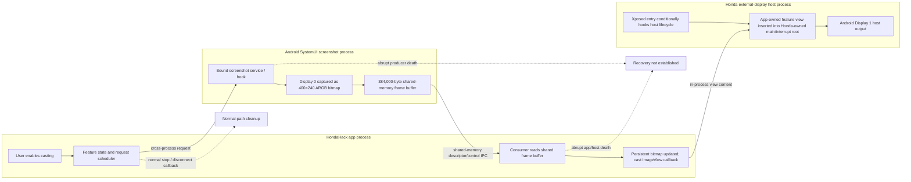

# CL-HH-06B — Display 1 data-flow analysis

**Verdict: B — new technical understanding, but NO-GO.** Offline static evidence describes a pixel-casting route and a distinct semantic/widget route. It does not establish a supported renderer-admission interface, safe ownership/revocation, warning priority, or crash-safe restoration. `safeForHonda() == false`.

## Scope and evidence handling

This is a sanitized architectural report based on the preserved HondaHack Pro 7.7.7 artifact, REA/JADX static inspection, and explicitly identified earlier private static notes. Exact class/method names, hook signatures, transaction details, private evidence IDs, and call graphs are retained only in authorized private storage. No APK was patched or executed, no vehicle service was invoked, and no vehicle was connected.

Labels: **OBSERVED_STATIC** means directly returned by static artifact inspection; **OBSERVED_HISTORICAL_RUNTIME** is limited to a prior preserved observation; **INFERRED** is a relationship or likely consequence not directly proven end to end; **UNKNOWN** lacks sufficient evidence; **UNSUPPORTED** was not found in the reviewed artifact/documentation; **REQUIRES_AUTHORIZATION** would need a separately authorized environment or action.

## Screen-casting pipeline

The figure separates three process owners: HondaHack schedules requests and consumes frames; SystemUI produces pixels; Xposed code in the Honda external-display process admits the app's view into Honda-owned windows. The app-to-SystemUI handoff is cross-process. The observed view insertion occurs in the host process. This is not a supported third-party renderer API or independent framebuffer/display surface.

| Stage | Finding | Class | Limit |
|---|---|---|---|
| User action and initialization | A preference/state handler changes casting state and schedules refresh work. | OBSERVED_STATIC | Exact UI-to-handler runtime ordering is not proven. |
| Producer selection and acquisition | The app binds to the Android SystemUI screenshot service; static inspection shows built-in Display 0 captured into a 400×240 ARGB bitmap. | OBSERVED_STATIC | No live capture, permission outcome, or timing was tested. |
| Frame representation and copy | The producer copies pixels into a reusable 384,000-byte shared-memory region, consistent with 400×240×4 bytes. | OBSERVED_STATIC | Source dimensions and buffer size do not establish downstream scaling or crop. |
| IPC / transport | Messenger control and a duplicated file descriptor establish a cross-process setup/update/close path. | OBSERVED_STATIC | Exact message values and private identifiers are withheld; no transport was exercised. |
| Consumer | The app-side receiver reads the shared region into a persistent ARGB bitmap and calls the cast view update. | OBSERVED_STATIC | Actual frame arrival and presentation are not runtime proven. |
| View admission | The bitmap is assigned to a HondaHack ImageView; Xposed code in the external-display host process inserts the containing feature view into a Honda-owned main or interrupt root. | OBSERVED_STATIC | In-process technical access is not caller authorization or a supported public API. |
| Display output | Earlier preserved Display 1 captures show an 800×480 Android host output. | OBSERVED_HISTORICAL_RUNTIME | Does not identify the physical cluster aperture, crop, mask, final scaling, or warning composition. |
| Normal teardown | Static stop/page-transition and disconnect callbacks close consumer resources or remove the view on normal paths; SystemUI disconnect handling also retries binding. | OBSERVED_STATIC | A callback path is not guaranteed after abrupt process death. Producer-side resource closure is not fully established in all branches. |
| Abnormal cleanup | Process death, stale-frame withdrawal, host restart recovery, duplicate attach handling, and factory-content restoration are not proven crash-safe. | UNKNOWN | No host-owned recovery contract was found; vehicle testing is unauthorized. |

The 400×240 source bitmap and 800×480 Display 1 host frame are distinct measurements from different stages. The physical Navigation viewport and any downstream transform remain **UNKNOWN**.

The dotted arrows indicate inferred failure outcomes, not observed behavior.

## Feature data-source and rendering matrix

| Feature | Primary data form | Renderer/consumer indicated by evidence | Vehicle/service relationship | Status |
|---|---|---|---|---|
| Screen casting | Captured pixels / bitmap frames | Bitmap-backed image content inserted into the external-display host | Screenshot producer plus host-view integration | Static path observed; complete runtime delivery inferred. |
| Advanced Meter | Semantic/widget inputs, including instrument values and navigation-related presentation | Custom in-process views using the shared injected host integration | Vehicle-data consumers may supply values; individual read side effects not fully classified | Shared host mechanism observed; not the screen-cast bitmap pipeline. |
| Factory Navigation integration | Navigation-page state and semantic content | Factory Honda navigation UI/content | Honda-owned navigation and services | Exact data flow and overlap with injected rendering are partially unknown. |
| Waze turn-by-turn | Semantic maneuver/guidance information would be distinct from screen pixels | Current artifact class searches did not establish an in-app Waze-specific producer; head-unit Waze observations are separate evidence | No HondaHack Waze source, consumer, or service authority is established | UNKNOWN. Do not attribute head-unit Waze behavior to this APK or equate semantic TBT with arbitrary frame admission. |
| Honda system-service interaction | Structured service/vehicle data or commands | Service clients feeding feature logic or widgets | Some methods may be read-only, control-capable, or mixed | Classify per method and transitive effects; a “get” name is not proof of purity. |

Thus, the observed screen cast is a pixel producer, while Advanced Meter is a semantic/widget renderer. Factory Navigation is Honda-owned navigation content. No HondaHack-specific Waze TBT producer was established; if such a semantic path exists, it is not equivalent to pixel-frame admission. The artifact does not establish that these features share one data/rendering pipeline.

## Manifest-first package boundary

The decoded manifest contains 23 activities, 2 services, 1 receiver, and 1 provider; it declares 22 permissions. The inspected manifest text contains no explicit `android:exported` or `android:process` attributes for these components. This bounded report does not determine effective export behavior from platform defaults or intent filters. The manifest does not declare Xposed metadata; a separate asset indicator and static entry-point inspection establish Xposed integration. Three ARMv7 native libraries are present, but JNI crossings relevant to the rendering path have not been established. Manifest component counts do not prove which components participate in this feature.

## Xposed and display ownership model

Static indicators and selected entry-point code show conditional Xposed integration into selected application processes, with hooks registered during package/process load and view operations performed in the host process. The observed Display 1 route depends on privileged in-process access to Honda-owned view structures, rather than a documented external renderer client contract.

| Question | Finding |
|---|---|
| Target processes | Selected Honda application processes are targeted conditionally. Exact process identifiers and hook signatures remain private. |
| Lifecycle | Entry-point handling occurs at package/process load; registration is conditional. Normal callbacks offer cleanup opportunities. |
| In-process vs cross-process | Host view insertion occurs in the Honda host process; frame production/transport includes cross-process communication. |
| Content ownership | Honda owns the host hierarchy; injected feature content is app-supplied. A formal shared ownership or lease contract is not established. |
| Callback registration and cleanup | Normal registration and detach/stop paths are statically visible. Universal callback delivery is not guaranteed. |
| Failure assumptions | Restart ordering, duplicate attach handling, stale content, and crash recovery remain unknown. |
| Caller authorization | No supported third-party caller authorization contract established. |
| Revocation/lease | No ownership lease, revocation handshake, or host-enforced lifecycle contract established. |

This model is an architectural description, not an implementation recommendation.

At the view-tree boundary, Honda owns the window roots and HondaHack supplies the inserted view. The normal code path contains detach/removal behavior, but there is no evidence of a host-enforced lease or guaranteed reclamation when the injecting app or host process terminates.

## Vehicle interface classification

| Boundary | Classification | Evidence limit |
|---|---|---|
| Screenshot request and Android display capture | READ_ONLY_OBSERVED | Reads system display pixels; exact permission and capture restrictions are not runtime checked. |
| Host view insertion | MIXED | Changes UI state in a Honda-owned process; its relationship to vehicle-control state is not established. |
| Honda system-service clients used by meter/features | UNKNOWN / potentially MIXED | Must trace downstream effects for each method; getter naming alone is insufficient. |
| Navigation-related service/data interfaces | UNKNOWN | Static semantic flow does not establish that downstream consumers are side-effect free. |
| Vehicle-bus mutation | UNKNOWN | No invocation was made; absence of an observed write in selected paths is not proof of a bus-free path. |

No vehicle-facing method was invoked. Any read-like call that triggers listeners, mode changes, wakeups, or downstream service effects would need separate side-effect analysis.

## Safety and restoration failure matrix

| Event | Normal path evidence | Abnormal behavior / restoration status |
|---|---|---|
| User exits feature | Static stop and cleanup paths exist. | Cleanup completion depends on callbacks and process state; no runtime guarantee. |
| Navigation page changes | Static page/feature transition handling exists. | Exact physical viewport bounds and restoration timing are unknown. |
| Factory warning or interrupt | One historical Door Open example is limited evidence of preemption behavior. | Universal warning priority, composition, or precedence is not proven. |
| Producer dies | Normal close signaling is represented in the static protocol. | Delivery of close after abrupt death and stale-frame cleanup are unknown. |
| Consumer dies | Normal disconnect cleanup exists. | Restart/rebind behavior and removal of already attached content are unknown. |
| Honda display host restarts | Load-time hooks may register again on a new process lifecycle. | Duplicate attachment prevention, ordering, and recovery are not guaranteed. |
| Repeated attach/detach | Normal lifecycle code has attach/detach handling. | Idempotence under races and resource release are unverified. |
| Factory content restoration | Normal paths indicate removal/transition behavior. | Crash-safe restoration and host-owned recovery are not established. |

## Interface decision

1. **Documented external renderer admission interface?** UNSUPPORTED by reviewed evidence.
2. **Observed drawing access dependent on privileged in-process code?** Yes, OBSERVED_STATIC for the reviewed path.
3. **Caller authorization established?** UNKNOWN; no supported authorization contract found.
4. **Ownership lease or revocation contract?** UNSUPPORTED by reviewed evidence.
5. **Physical Navigation viewport bounds established?** UNKNOWN.
6. **Warning priority proven?** No. A limited historical Door Open observation cannot establish universal priority.
7. **Factory restoration crash-safe?** UNKNOWN; not proven.
8. **Relevant path free of vehicle-bus mutation?** UNKNOWN; selected static evidence and no invocation do not prove this.
9. **Material change to CL-R10B/CL-R10C?** Adds a more specific observed pixel pipeline and separates it from semantic/widget rendering. It does not change their no-supported-interface conclusion or NO-GO decision.

**Decision: retain NO-GO.** No supported API or adequate safety contract has been established. Do not infer a possible implementation from private technical access.

## Findings compared with prior display research

- **CL-R10B** established the bounded display-ownership result: Honda owns the host view roots, reviewed evidence did not establish a supported arbitrary-frame admission/revocation contract, and the single warning observation has limited generality. This report adds a source-backed description of HondaHack's bitmap producer-to-host path, while keeping the same authorization and restoration gaps. See [CL-R10B](cl-r10b-display-ownership.md).
- **CL-R10C** retained NO-GO pending an authorized host contract, warning/preemption evidence, teardown, recovery, and a safe bus boundary. This report separates HondaHack's pixel-copy path from semantic/widget rendering; it does not satisfy any of those gates. See [CL-R10C](../native/cl-r10c-integration-architecture.md).
- The more specific static path is not evidence of a supported interface. It does not establish caller authorization, physical viewport geometry, process-death cleanup, universal warning priority, or bus purity.

## Highest-value unknowns and CL-SYS-01 questions

### Selected static research seeds

| Seed | Why selected / current producer–consumer understanding | Still unverified / next static question |
|---|---|---|
| Screen casting | Preference-driven request scheduling connects to the SystemUI pixel producer, app bitmap consumer, and host-process view insertion described above. | Independently reproduce each transition from the current DEX; establish frame drop/stale-frame behavior and all cleanup branches. |
| Advanced Meter | Its settings and shared host integration distinguish semantic/widget content from the cast bitmap path. | Trace displayed values to each producer and classify downstream service side effects. |
| Waze TBT | The current class search did not establish an in-app Waze-specific producer; separate head-unit observations are not evidence about this APK. | Search exact resources, intents, and navigation callbacks; determine whether any semantic producer/consumer exists. |
| Factory Navigation | Navigation-related preferences exist, but the inspected activity lifecycle does not prove control of Honda's factory renderer. | Trace page-state callbacks and app/service interactions without invoking them. |
| Honda system services | The app service registers broadcast, location, and timer work, but this does not classify vehicle interfaces. | Follow each service client transitively; classify read-only, control-capable, mixed, or unknown, including indirect effects. |
| Process startup/shutdown | App service start/destroy and Xposed package-load entry establish separate lifecycle boundaries. | Determine what happens across app, SystemUI, and host restarts; normal callbacks do not establish recovery after process death. |
| Warning/restoration | Main/interrupt host roots and one limited Door Open observation make interrupt handling a high-value boundary. | Establish universal warning precedence, viewport bounds, stale-frame withdrawal, and factory restoration from an authoritative host contract. |

Private evidence IDs and exact implementation references for these seeds are retained in authorized private notes, not this report.

- Does Honda provide a documented external renderer admission API with caller identity checks, explicit display/viewport bounds, and host-owned lifetime enforcement?
- What ownership, revocation, and recovery contract applies if the producer, renderer, or host process exits unexpectedly?
- How are factory navigation content and safety warnings prioritized, and is that policy enforced by the host independently of third-party lifecycle callbacks?
- Which Honda service interfaces are observational, control-capable, or mixed after following their transitive effects?
- Can the supported interface guarantee no vehicle-bus mutation for a renderer-only client?
- What evidence defines the physical navigation viewport and scaling/crop policy for each supported head-unit configuration?
- Does the host restore factory content after process death, repeated attach/detach, and host restart without relying on the injected client?

## Limitations

This is static analysis of one preserved version. It does not prove runtime behavior, installation authenticity, compatibility with other builds, warning arbitration, screen geometry, service side effects, crash recovery, or safe vehicle operation. The live Codex MCP Android provider still requires restart/revalidation; successful REA CLI calls and a prior Ghidra smoke test are not substitutes for that check. Private evidence records remain outside public GitHub. No APK modification, injection execution, Honda ADB, vehicle connection, private service invocation, or CAN activity occurred.
