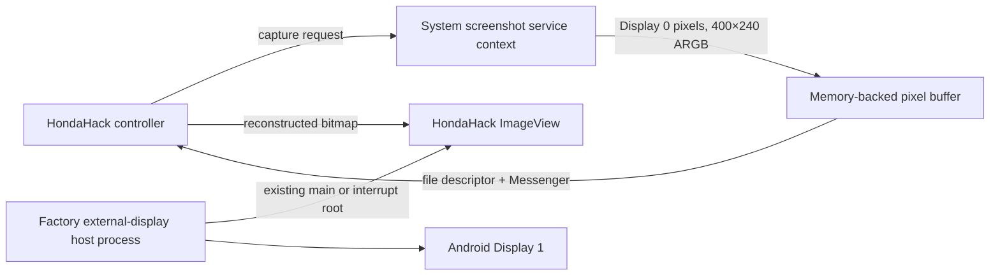
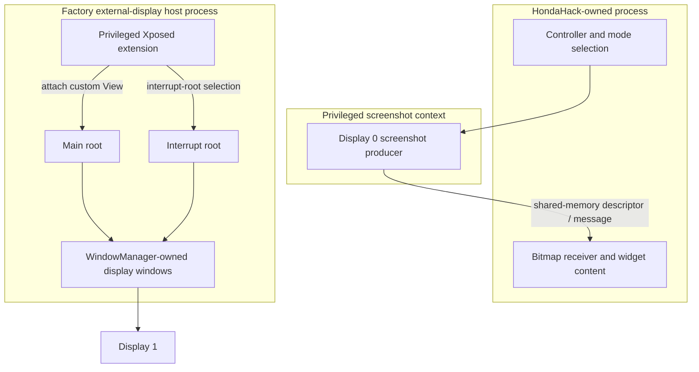

# CL-HH-07 — HondaHack display architecture assessment

**Date:** 2026-10-21
**Scope:** read-only static analysis of the owner-preserved HondaHack Pro 7.7.7 package and selected Honda Android display, Navigation, and CarPlay components. No Honda connection, ADB, APK execution, artifact modification, private-service invocation, or vehicle operation was performed. `safeForHonda() == false`.

## Executive verdict

**Verdict B — new factory-package and ODEX understanding, but Honda integration remains unsupported.** The exact HondaHack copy was re-identified by its preserved digest and package metadata. A live REA/JADX provider is now working. The factory application code is held in paired API-17 Dalvik ODEX files; reading them required a matching framework dependency set and an ODEX-aware disassembler. The resulting static inspection confirms the previously documented View-based output path and exposes a factory Binder surface for structured content and display state. It does not expose an arbitrary-frame admission contract.

HondaHack remains a private, privileged in-process precedent. It captures pixels from the built-in display, transports a bitmap to its own process, then adds a View in the factory display host. That path differs from ClarityLink’s synthetic Type111 receiver pipeline. It supplies no evidence that Type111 is accepted by the car, that an independent app can submit frames through a supported API, or that factory warning priority and crash restoration are safe.

**Decision:** retain the CL-R10C Honda integration NO-GO. Do not change the CL-R12 IPC or rendering design based on this evidence. No implementation change is justified.

## Verified artifacts and analysis readiness

The examined package is HondaHack Pro **7.7.7**. Its package identity, manifest, API levels, permission declarations, one DEX inventory, resource inventory, and native-library inventory were read by live REA/JADX. The package declares root and system-sensitive Android permissions and contains ARMv7 native libraries. Those declarations show privilege assumptions; they do not establish the publisher’s identity or validate its signature. Signature verification was not performed.

Selected factory packages were read manifest-first from the existing system/vendor preservation set. Each application’s compiled code is paired with a Dalvik ODEX version 036 file. The matching factory framework, external-display, Navigation, and UI dependencies were used to deodex read-only copies. All six selected application/library ODEX targets produced smali output without skipped classes after the complete factory classpath was supplied. No source archive or original component was changed.

Tool readiness for this pass: REA 6.7.0; live JADX provider 0.7.1; OpenJDK 21.0.13; Ghidra 12.1.4; baksmali 3.0.10. Apktool and JEB were unavailable. Baksmali’s documented ODEX mode with the target API level and matching dependency files is the appropriate inspection route for this pre-ART Dalvik format; the development SDK is not a substitute for those recovered files. See the [upstream deodex guidance](https://github.com/JesusFreke/smali/wiki/DeodexInstructions) and [release history](https://github.com/baksmali/smali/releases).

The host APK manifest alone contains only a minimal application class inventory; the application implementation is in its ODEX. A failed or sparse JADX APK inventory therefore does not mean the factory service or API is absent.

## Feature and process architecture

### Screen Casting

The static source path is:

The path uses screenshot pixels as input, memory-backed IPC between capture and consumer, then a regular Android View for output. It does not use the HondaHack native libraries for the traced pixel path, and the inspected output route does not write a framebuffer or draw decoded video directly to a native surface. The factory host owns the display windows; HondaHack obtains in-process execution through its Xposed integration and attaches a child View to the host’s existing hierarchy. This is evidence of a private capability, not an authorized ClarityLink interface.

### Advanced Meter

Advanced Meter is a separate content mode. It builds Android widgets and shares HondaHack’s host View infrastructure, but it is not the Screen Casting bitmap producer. Factory host code also subscribes to Navigation turn guidance, vehicle/status, emergency, and external-display events through vendor service interfaces. The evidence supports a semantic callback/data path for factory content; it does not prove every HondaHack meter field uses the same callback, nor that those services are side-effect-free.

### Process ownership

Static process selection and the exact private hook implementation remain private. The diagram shows the observed ownership boundary at a high level. A process death may bypass normal callbacks; static `onDestroy` behavior cannot prove crash-safe removal.

## Factory components and API boundary

The preserved factory set contains separate external-display output and companion-service packages, a shared external-display Binder/JAR library, Navigation and CarPlay application/service pairs, matching API-17 ODEX files, and ARM EABI5 native receiver/system libraries. The package manifests and ODEX class inventories are distinct from the development Android SDK.

The external-display Binder declaration includes structured meter-content and display/status operations and callbacks. Its reviewed method signatures do not describe a `Surface`, `Bitmap`, file-descriptor frame, or arbitrary pixel-buffer input. The service is declared exported, but export alone does not establish a documented third-party contract, authorization policy, process lease, or safe ownership. The manifest also declares privileged system and vehicle permissions; exact enforcement and caller behavior remain unverified. Some service operations are control-capable, so do not treat the entire Binder family as observational.

The relevant factory relationship is therefore:

- factory host: owns the Android window roots and composes factory/custom Views;
- companion service and Binder library: exchange structured content, state, callbacks, and some control-capable operations;
- Navigation service: supplies semantic guidance and other Navigation state to factory clients;
- CarPlay/native receiver components: form a separate CarPlay media/authentication path;
- HondaHack: privately injects into the host and renders its own view content.

No evidence connects HondaHack’s bitmap transport to the native CarPlay proxy or proves that this Binder interface admits Type111 video.

## Display geometry

Historical observations report Android Display 1 at 800×480, HondaHack capture at 400×240, a 584×215 local layout, and a 584×191 ImageView region after top padding. The ImageView uses `fitXY` in the examined layout. These values describe different layers and are not interchangeable.

| Coordinate system | Evidence | Limit |
|---|---|---|
| Source screenshot | 400×240 | Built-in Display 0 capture input. |
| HondaHack ImageView | 584×191 local region | App layout-local dimensions. |
| HondaHack parent layout | 584×215 | Not an OEM viewport. |
| Android Display 1 | 800×480 | Full-frame Android display/layer observation. |
| Physical Navigation aperture | Unknown | Downstream crop, mask, and physical visible bounds are not established. |
| CarPlay safe region | Unknown | No geometry transfer from HondaHack is justified. |

Do not use the HondaHack layout as an OEM safe area. Navigation selection, main/interrupt roots, and physical composition need separate authoritative proof.

## Navigation, Waze, and Type111

The factory Navigation service exposes semantic turn-guidance relationships to factory components. HondaHack’s previously inspected APK does not establish a dedicated Waze turn-by-turn producer. A HondaHack preference or generic navigation widget is not evidence that it consumes Waze guidance.

Keep these claims separate:

- **Semantic TBT:** structured icon, distance, or route-state data.
- **Type111 video:** a separate CarPlay screen stream with its own negotiation, session, transport, and decoded frames.

This investigation finds no proof that HondaHack renders independent CarPlay Navigation video or that a semantic guidance callback is a Type111 video path.

## Lifecycle and failure-state assessment

| Trigger | Static path observed | What remains unproven |
|---|---|---|
| Normal feature stop | HondaHack has stop/cleanup code; the factory host exposes root-view and content lifecycle operations. | Host-side removal when the HondaHack process disappears unexpectedly. |
| Normal factory host shutdown | The recovered host service unregisters callbacks, unbinds services, and removes active content through its shutdown path. | Whether all root windows are removed in every shutdown ordering. |
| HondaHack process crash | No guaranteed callback can be assumed. | Stale View removal, watchdog behavior, duplicate attachment prevention, stock restoration. |
| Host process death/restart | Factory state is recreated through service lifecycle. | Re-attachment ordering, stale bitmap handling, and restoration under abrupt death. |
| Navigation page change | Main and interrupt content roots exist; navigation and display callbacks are present. | Universal page-selection, overlay-priority, and safe-area policy for HondaHack content. |
| Warning interruption | One historical Door Open observation is documented in earlier work. | Universal warning priority, preemption, and restoration guarantees. |
| Shared-buffer/consumer failure | Producer and consumer are separate stages in HondaHack’s static path. | FD lifetime, frame timeout, stale-frame withdrawal, and final cluster effect for all failures. |

No crash-safe restoration or universal factory-warning priority is established.

## Vehicle-interface risk classification

| Relationship | Classification | Basis and limit |
|---|---|---|
| Display screenshot capture | Observational input | Captures built-in pixels; does not show a vehicle bus transaction. Does not prove all app behavior is read-only. |
| Factory host View insertion | Mixed | Changes displayed content inside a privileged host process. Safety priority and ownership policy are unknown. |
| Factory navigation/status subscriptions | Observational in the inspected callback direction | Registration and callback shape are visible; remote implementation side effects are not fully proven absent. |
| Factory display/content Binder family | Mixed / control-capable | Declarations include status/content callbacks and state-changing controls. No invocation was performed. |
| CarPlay native callbacks | Unknown outside the bounded static receiver analysis | A callback registry is not evidence of an authorized renderer or HondaHack link. |
| Warning arbitration and crash restoration | Unknown | Historical observation and cleanup callbacks are insufficient for universal guarantees. |

No factory service was called during this work.

## HondaHack versus CL-R12

| Stage | HondaHack 7.7.7 | CL-R12 synthetic receiver |
|---|---|---|
| Input | Screenshot of Display 0 | Synthetic Type111 H.264 access units / fixture data; real Honda Type111 remains unproven. |
| Nominal size/rate | 400×240 bitmap; a saved quality preference requested a low nominal cadence, not measured sustained FPS. | 800×480 output target and 30 FPS offered workload in the synthetic lab. |
| Transport | MemoryFile/PFD and Messenger between capture and bitmap consumer. | MemoryFile/PFD/Messenger plus receiver parsing, frame verification, decode, bitmap conversion, and View delivery in the lab. |
| Render owner | View inserted into factory host via privileged in-process integration. | Synthetic renderer/view owner in the lab; no Honda display admission demonstrated. |
| Main cost questions | Screenshot capture, shared-buffer copy, bitmap reconstruction, scaling, UI invalidation. Runtime cost was not benchmarked here. | Full-frame validation, decode, conversion, allocation, Binder/FD lifetime, synchronization, and frame pacing. |

The input formats, pixel sizes, ownership model, and workload differ. A working low-rate mirror does not show that the Honda path can sustain 30 FPS, accept Type111, or outperform the synthetic pipeline. Existing CL-R12 timing and acceptance limits remain the applicable source for the laboratory design; see the [Type111 renderer handoff contract](../display/type111-renderer-handoff-contract.md) and [current integration feasibility assessment](../../docs/research/cl-r9-genuine-honda-feasibility.md).

### Engineering decision questions

1. **Different transport?** Yes. HondaHack mirrors captured pixels over shared memory and renders a bitmap through a host View; CL-R12’s synthetic input starts at Type111 media parsing and decoding.
2. **Which operations allocate/transport/render?** Screenshot capture obtains Display 0 pixels; HondaHack allocates/reconstructs a bitmap; a memory-backed descriptor and Messenger carry it; a View displays it in the factory host process. Advanced Meter creates custom widgets and is separate from screenshot casting.
3. **Why not infer 30 FPS?** The observed source is half the Display 1 width and height, has a saved nominal low cadence rather than a sustained measurement, uses scaling, and has no Type111 session, decoder, pacing, or admission contract in evidence.
4. **Supported third-party frame API?** None demonstrated. The inspected factory Binder boundary is structured content/status/control, not arbitrary pixels or a surface handoff.
5. **Navigation selection, warning priority, crash restoration?** Not proven.
6. **What remains in each research domain?** HondaHack: exact process-selection edges, all feature-specific meter data sources, and abnormal cleanup. Factory OS: Binder caller authorization, view/window ownership policy, service restart semantics, warning priority, and any documented frame-admission contract.
7. **Which findings justify changing CL-R12 IPC?** None. The evidence only reinforces stage and ownership separation.
8. **What is premature optimization?** Replacing the synthetic transport with HondaHack’s screenshot transport, raising frame cadence based on a preference, or comparing FPS without equivalent input, resolution, queue, timing, and failure conditions.
9. **What must precede an adapter?** An OEM-supported API, caller authorization model, explicit frame/source format, process and lease ownership, teardown/revocation semantics, physical geometry, warning policy, and independent API-17 failure evidence.
10. **Does NO-GO remain?** Yes. Private Xposed execution and privileged factory windows do not relax the NO-GO.

## Evidence method, provenance, and limits

**OBSERVED_STATIC** denotes parsed package/manifest/DEX/ODEX/ELF structure or disassembly. **HISTORICAL_RUNTIME** refers only to earlier retained observations. **INFERRED** marks relationships drawn from static cross-component references. **UNKNOWN** marks unanswered ownership, safety, or runtime behavior. No static result establishes a supported integration API or vehicle safety.

The current pass used the owner-preserved APK and system/vendor backup. Exact hashes, REA Evidence IDs, ODEX-derived method locations, and detailed private call relationships are retained in the private CL-HH-07 evidence index. This public report contains no binaries, decompiled methods, exact hook signatures, Binder transaction values, vehicle captures, private filesystem locations, or credentials. Ghidra was used on the relevant ARM CarPlay proxy boundary; it did not establish a HondaHack-to-Type111 path.

Testing was limited to static parsing, hash comparison, archive inventory, ODEX deodex/disassembly, and documentation review. No application or factory binary was executed. No runtime, warning, service, or vehicle test is claimed. Independent ECC code/security reviewer feedback was not available through the connected tools; the publication audit is self-review, not independent approval. ECC approval is not vehicle safety certification.

## Recommendation and publication

Keep the NO-GO and synthetic CL-R12 design. The smallest justified next research task is to obtain an OEM-approved, documented frame-admission and authorization contract, including display ownership, warning arbitration, revocation, geometry, and process-death restoration. Until that evidence exists, continue only offline analysis and synthetic performance work.

This report is tracked by [issue #56](https://github.com/bmreyes25/ClarityLink/issues/56), cross-references [renderer contract issue #60](https://github.com/bmreyes25/ClarityLink/issues/60), and is published in [CL-HH-07 pull request #67](https://github.com/bmreyes25/ClarityLink/pull/67). It does not modify PR #52 or any vehicle-facing implementation.

## Public sources

- [HondaHack Display 1 data flow](hondahack-display-path.md)
- [HondaHack static-analysis limits](hondahack-static-analysis.md)
- [CL-HH-07 performance architecture comparison](../../docs/research/honda/hondahack-performance-architecture-comparison.md)
- [Factory display host flow](../display/externaldisplay-host-flow.md)
- [Honda frame-admission review](../../docs/research/cl-r9d-hondahack-frame-admission.md)
- [Honda integration feasibility](../../docs/research/cl-r9-genuine-honda-feasibility.md)
- [Synthetic Type111 render handoff](../display/type111-renderer-handoff-contract.md)
- [Factory/native integration architecture](../native/cl-r10c-integration-architecture.md)
