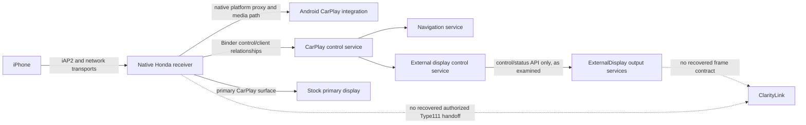

# CL-R10A — Honda Type111 receiver authority and stream handoff investigation

**Status:** offline evidence review complete; no Honda compatibility demonstrated
**Target:** 2018 Honda Clarity PHEV Touring, MY16ADA, Android 4.2.2/API17, ARMv7/Tegra class
**Safety gate:** `safeForHonda() == false`; this report authorizes no vehicle, receiver, phone, or firmware operation
**Evidence date:** 2026-10-20

## 1. Executive findings

The preserved Honda receiver evidence does **not** show a legitimate Type111 negotiation or stream handoff to ClarityLink. A native receiver process owns the observed iAP2/USB and network transport machinery and creates/manages the CarPlay receiver session. The exact association between iAP2 authentication transition state and that AirPlay receiver session is not proven. The reviewed build constructs `/info` from one configured main-screen descriptor, and its Control SETUP handler dispatches the observed Type110 path while taking the unsupported/default branch for Type111. No supported callback, registration API, service contract, or media sink delegates a receiver-owned secondary stream to an external ClarityLink process.

The public open-source implementations demonstrate that Type111/AltScreen is viable on specific Audi/VW MHI2/MHI2Q/QNX stacks. They do not establish Honda's descriptor schema, feature agreement, authentication/session sharing, transport security, callback ABI, lifecycle, or frame ownership.

The correct verdict is **C. NO SUPPORTED HANDOFF FOUND IN EXAMINED EVIDENCE**.

CL-R4 API17 reliability acceptance and CL-R7 API17 end-to-end laboratory acceptance remain accepted baselines. They establish the ClarityLink side using synthetic streams and fixtures. They do not establish Honda negotiation or delegation. Historical Type111-first traces with separate IDs, ports, and frames are parser/trace evidence only; they are not proof of Honda authentication, decryption, acceptance, or delegation.

## 2. Verified current baseline

### Repository state at campaign start

The preserved source checkout was `claritylink-cl-r9`, on `feature/cl-hh-03-view-observability`, initial HEAD `dfddb787e3faecc7d897e74dd02537e4928c6d3a`. Its worktree was clean. That branch had one unpublished commit, `dfddb78 Add offline View observability contract`, relative to its upstream. `origin/main` was fetched at `91562137448f78bc6a8b890d011b4c5185afea79`.

To preserve that work and existing PR #46, this report was created in a separate worktree from `origin/main`, on `feature/cl-r10a-type111-receiver-handoff`. Thus the report branch baseline is `9156213`; it does not absorb or replace the CL-HH branch.

### Milestones

- **CL-R4: API17 reliability acceptance PASS.** The repository records all mandatory reliability cases and priority combinations passing against the documented source/APK fingerprints.
- **CL-R7: API17 end-to-end laboratory PASS.** Type110-first and Type111-first synthetic setup, actual H.264 decode/pixel checks, Binder/PFD transfer, warning preemption/recovery, Type110 continuity, process recovery, generation validation, teardown, and cleanup were exercised.
- Neither milestone is evidence that Honda offered, accepted, authenticated, decrypted, or delivered a genuine Type111 stream.
- `safeForHonda()` remains unconditionally false.

### Relevant PR state at campaign start

Verified with `gh pr list --state all`:

| PR | State | Relevance |
|---:|---|---|
| #40 | Open | CL-R9 fail-closed Honda display boundary |
| #41 | Merged | CL-R9A Honda Control SETUP evidence boundary |
| #42 | Merged | CL-R9B Type111 handoff boundary |
| #43 | Open | CL-R9C Honda Display 1 frame-admission boundary |
| #44 | Open | CL-R9D HondaHack frame-admission evidence gap / R9E readiness |
| #45 | Open | CL-HH-02 synthetic cluster geometry |
| #46 | Open | CL-HH-03 offline View observability |

This campaign is scoped to receiver negotiation and stream handoff. It does not supersede the parallel display/output work in #40 and #43–#46.

## 3. Receiver process architecture

The preserved topology and static analysis support the following limited model:



The native receiver owns the observed iAP2/USB machinery and network sockets, loads the platform CarPlay proxy, and reaches the media path. It also creates/manages the AirPlay receiver session. The preserved call graph does not prove how the separate iAP2 authentication transition state is associated with that AirPlay session. Android CarPlay and external-display services are adjacent control/render components. Their presence and Binder relationships do not prove that they own the receiver session or receive its stream keys, sockets, compressed frames, or decoded frames.

The live topology snapshot is corroborative but intentionally limited: process handles, mapped libraries, sockets, named surfaces, and service bindings establish topology only. Socket payloads were not classified as particular CarPlay channels. A service binding does not prove route data or video traversed it.

## 4. `/info` construction analysis

The static call/data flow documented by the preserved analysis is:

1. The native AirPlay server-info path builds a server dictionary.
2. The `displays` property path creates an array and asks the screen-info builder for one descriptor.
3. The screen-info builder obtains the configured main-screen object once and copies its properties into one dictionary.
4. The property path appends that dictionary once; the binary-plist `/info` serializer and HTTP response path serialize it.

The recovered descriptor fields include `edid`, `features`, `maxFPS`, physical/pixel dimensions, and `uuid`. Their presence is evidence about the stock Type110 display description only. The `features` bit semantics, advertised UUID value/stability, and a display-role discriminator were not established. The CFArray can represent multiple entries, but the stock builder examined creates one. A generic array is not an extension point.

**Answer to C/D:** the native receiver constructs/supplies the `/info` response. Screen capability values originate in the native screen/configuration path; no supported external configuration interface for adding a second Apple-facing screen was found. No Honda secondary-screen descriptor builder or proven UUID-to-stream-ID mapping was recovered.

## 5. Control SETUP analysis

The preserved native receiver Control SETUP path iterates the request's stream entries by explicit `type`. The known Type110 branch consumes a nonzero `streamConnectionID`, configures its screen stream/security state, opens a dynamic listener, and contributes its Type110 response entry/port. The unknown/default branch logs/skips unsupported stream types and continues. Therefore the implementation can encounter mixed or differently ordered arrays at the parser level; this is not evidence it negotiates Type111.

The handler does not establish a Type111 response schema, stream ID echo, listener, authorization result, key derivation, decoder state, or callback. A successful local response/serialization predicate means only that the local response was built/sent along that code path; it does not prove iPhone acceptance or stream delivery.

The existing ClarityLink Type111 SETUP contract is explicitly a synthetic transaction model, informed in part by MHI2 prior art. Its listener and `dataPort` candidate, prepared-generation ownership, rollback, exact-once modeled serializer behavior, and Type110 preservation tests do not create a Honda handler or Honda authority. Do not promote those synthetic fields to Honda wire contract.

## 6. Type111 negotiation analysis

| Question | Finding | Classification |
|---|---|---|
| Can the descriptor container encode multiple screens? | Yes, an array can hold multiple values. The stock builder emits one descriptor. | Honda static evidence; high confidence |
| Is a second Apple-facing descriptor constructed? | None found in the examined builder/callers. | Negative finding in examined path; high confidence within scope |
| Are secondary capabilities advertised? | No Type111/secondary-screen advertisement was established. `features` is opaque. | Honda unknown / unsupported in examined path |
| Is `extendedFeatures` negotiated? | No Honda `/info` or Control SETUP handling for this feature was established. | Not found; medium-high confidence |
| Is `enabledFeatures` agreed? | No Type111 feature-agreement handler was found. | Not found; medium-high confidence |
| Is `altScreen` negotiated? | No Honda control-plane implementation or acceptance evidence was found. | Not found; high confidence in examined static path |
| Is Type111 Media SETUP implemented? | Type111 is skipped by the stock stream dispatch. | Honda static evidence; high confidence |
| Are Type111 VideoConfig/connection IDs handled? | No Honda Type111-specific processing or field mapping was found. | Honda unknown / unsupported in examined path |
| Does historical Type111-first activity prove Honda? | No. It proves only the source trace/parser observation in the provenance that recorded it. | Explicit distinction |

`honda_type111_setup_dispatch` remains the blocking requirement: evidence that the reviewed Honda receiver session dispatches Type111 to a handler, plus evidence of how that session is legitimately associated with authentication and how the handler is authorized to receive negotiated identity/configuration and deliver the stream through a documented or receiver-owned interface. The iAP2 authentication-to-AirPlay-session association remains unproven. A synthetic setup parser, a response mutation seam, an MHI2-shaped descriptor, a reachable native callsite, or a Type111 request trace is insufficient.

## 7. Stream ownership analysis

The examined architecture is not proven to be a universal one-stream implementation: it has arrays/collections, generic stream allocation/dispatch machinery, and multiple media components. It is, however, configured around one `/info` primary screen and the stock screen callback path is singleton/main-screen oriented. The most accurate conclusion is **one configured primary screen is established; receiver support for additional independently negotiated streams is not**.

Type110 playback is established through the stock main-screen setup and media path. Its `streamConnectionID` is consumed for Type110 security setup, and the receiver creates/owns the corresponding transport/listener and decode/display path. Those details are Type110 facts only. No shared mutable Type110 state may be treated as Type111 authority.

The proxy's callback/table machinery is Honda-owned. The inspected lifecycle reports found replacement-style callback installation rather than a demonstrated additive subscription/chaining API. Replacing the table could displace Honda callbacks; no child-stream cleanup registration mechanism was found. A raw session pointer is not a stable public session identity or generation token.

## 8. Audi/Honda comparison

The Honda artifact basis is MY16ADA software build `1.F1A2.45` as identified by the existing public-safe receiver audit. The three references were inspected at their `main` HEADs on 2026-10-20. Pinning these commits makes the review reproducible; it does not imply code compatibility or licensing permission.

| Reference / inspected revision | Demonstrated source or reported behavior | Portability to Honda |
|---|---|---|
| [`luka-dev/mib2q-carplay-rgi`](https://github.com/luka-dev/mib2q-carplay-rgi) — `71b4ab1c9461d5383a7aa6d56d4dda34f567ade7` | Audi MIB2Q/QNX CarPlay RGI/cluster/HUD work. Repository describes a platform-specific RGI and secondary display path. | Architectural prior art only. QNX/MIB2Q native services, receiver ABI, display and session ownership are not Honda Android contracts. |
| [`harman-f/mhi2_altscreen_carplay`](https://github.com/harman-f/mhi2_altscreen_carplay) — `47b1dcc30d25c01bd32b7f35a03380803aeea64e` | MHI2 AltScreen work reports real Stream-111 navigation video on its stated VW Group stack, including platform-specific transport to its virtual cockpit. | Strong evidence that genuine Type111 can work on that receiver/platform. Its /info fields, `altScreen` agreement, listener, MPEG-TS/MOST path, and lifecycle are not established for Honda. |
| [`edzenis/mib2high-carplay-altscreen-rgi`](https://github.com/edzenis/mib2high-carplay-altscreen-rgi) — `bfea86859a5bdaed3c29a16f03fc7ba87ef4a19e` | Audi MIB2 High/MHI2 RGI/AltScreen repository describes HUD route guidance and cluster map features, with its own native/Java/platform boundary. | Audi BAP/HUD and MHI2 receiver integration are not Honda services or authorities. Reuse only general separation ideas after independent Honda proof. |

| Mechanism | Evidence class | Honda status |
|---|---|---|
| Multiple display / stream descriptors and Type111 support in AltScreen projects | Demonstrated by source; portions reported as vehicle-tested on named platforms | Unsupported on Honda |
| Type111 request ordering and independent stream identifiers in preserved iOS traces | Parser/trace observation for that provenance | Does not establish Honda acceptance |
| Secondary feature advertisement and `altScreen` agreement | Prior-art protocol implementation/analogy | No Honda implementation found |
| Per-stream ports/transport and lifecycle | Demonstrated in reference source/platform | Honda Type111 transport and connection lifecycle unknown |
| VideoConfig and stream-to-display identity mapping | Must be checked against each implementation's source; not assumed portable | Honda mapping not found |
| OEM session/auth sharing and media callback | Platform-specific in each reference | No Honda extension interface found |
| Type110 continuity during Type111 failure | Desired ClarityLink invariant and some platform-specific demonstrations | Honda behavior with Type111 absent because no Type111 branch |

**Explicitly not inferred:** cryptographic algorithm or keys; session-master reuse; Type111 authorization; descriptor UUID semantics; memory ownership; callback ABI; permissions; parser/framing; decoder reuse; or failure/reconnect semantics. GPL source is not copied into ClarityLink, which has no selected license.

## 9. Candidate handoff interfaces and hypotheses

### Option A — Existing receiver-owned callback/registration interface

- **Evidence:** Honda has internal callbacks and a native media path; no additive Type111 registration/callback contract was recovered. Existing callback storage appears Honda-owned and replacement-oriented.
- **Missing:** a documented/exported registration API, callback semantics, ownership, session+stream identity, VideoConfig, authorized frame source, revocation, and teardown linkage.
- **Privileges/changes:** unknown; must be an authorized API and must not replace the stock callback table.
- **Authentication / Type110:** could preserve stock auth and Type110 if the receiver itself vends the stream; not demonstrated.
- **Recovery/security/safety:** unknown until ownership and independent teardown are specified; no candidate can be run against a vehicle under this campaign.
- **Feasibility:** not established.
- **Decisive next evidence:** OEM/API documentation or receiver source/ABI plus a legitimate callback registration example showing Type111 lifecycle and Type110 independence.

### Option B — Honda-owned service or documented extension surface

- **Evidence:** CarPlay and ExternalDisplay services are present and expose control/status operations. Examined ExternalDisplay APIs do not expose a media/frame sink, and no CarPlay service method transfers authenticated Type111 stream state.
- **Missing:** supported service contract accepting receiver-authorized frames/configuration, caller authorization/permission, lifetime and error contract.
- **Privileges/changes:** unknown. An exported component alone does not establish permission to call it or authorization to receive protected content.
- **Authentication / Type110:** theoretically compatible if the service is called by the stock receiver with receiver-produced frames; no such path is proven.
- **Recovery/security/safety:** unclear; second-hand pixel forwarding outside ownership raises freshness, caller-authentication, and revocation risks.
- **Feasibility:** unsupported in examined interfaces.
- **Decisive next evidence:** documented service API or source proving an authorized receiver-to-consumer media call.

### Option C — Latent/disabled stock secondary-stream support

- **Evidence:** array-shaped containers and generic media code exist; current screen-info builder emits one descriptor and SETUP skips Type111.
- **Missing:** an actual Honda Type111 branch, enabling/configuration source, feature mask semantics, schema, and verified downstream stream sink.
- **Privileges/changes:** unknown; even “disabled” support would require an authorized configuration/control surface.
- **Authentication / Type110:** not established.
- **Recovery/security/safety:** not assessable without the missing handler and teardown semantics.
- **Feasibility:** possible in abstract, unsupported by examined evidence.
- **Decisive next evidence:** an unmodified Honda version/source/build showing the capability gate and dormant Type111 handler, plus a supported enablement mechanism.

### Option D — Replace or intercept stock session behavior

- **Evidence:** prior private models explored patch/interposition possibilities, but no supported additive receiver-owned extension was established. The stock session callback table and cleanup path are Honda-owned.
- **Missing:** authorized modification rights, stable ABI, authentication ownership, safe callback chaining, complete cleanup/recovery, and an independently approved vehicle safety case.
- **Privileges/changes:** would likely require privileged native interception/replacement or binary/runtime modification.
- **Authentication / Type110:** at risk; any code taking over connection/session ownership could disturb authentication, Type110, audio, or OEM recovery.
- **Recovery/security/safety:** materially higher risks; this campaign must not implement or exercise it.
- **Feasibility:** technically speculative; not an authorized handoff candidate.
- **Decisive next evidence:** this option cannot be advanced by technical reachability alone. It would first require explicit OEM-supported integration authority and safety review.

### Option E — No feasible/authorized path currently demonstrated

- **Evidence:** stock `/info` is single-screen in examined builder; Type111 SETUP is skipped; no handoff interface/media sink or supported callback chaining found; external prior art is platform-specific.
- **Missing:** smallest evidence item is a Honda-owned, supported contract proving (1) authenticated Type111 acceptance and identity/config delivery and (2) receiver-authorized frame delegation with teardown.
- **Privileges/changes:** none justified until that contract exists.
- **Authentication / Type110:** stock receiver remains sole owner; no delegation currently occurs.
- **Recovery/security/safety:** conservative, fail-closed state preserves the accepted stock behavior; no new code should claim support.
- **Feasibility:** **current evidence-backed conclusion**.
- **Decisive next evidence:** the OEM or authorized Honda receiver integration contract described above.

## 10. Authorization boundary

Technical ability to observe a process, map a library, call an exported component, or reach an internal native function is not authorization to receive/decrypt protected media or take ownership of the authenticated session. No credential extraction, authentication bypass, forged session ownership, or protected-media interception is proposed or implemented.

The only acceptable future handoff would originate from the Honda receiver after it has authenticated the iPhone and negotiated the stream, and would explicitly authorize the recipient and bound its lifecycle to that session. Until evidence shows such a Honda-owned interface, the ClarityLink adapter remains a design proposal, not an integration surface.

## 11. Type110 preservation requirements

Any later OEM-supported adapter must satisfy all of the following before it is considered:

1. Honda remains owner of the authenticated iAP2/CarPlay session and all existing Type110 setup, crypto, transport, decoder, audio, and primary presentation.
2. Type111 has separate stream and connection identity, config, transport, generation, cleanup, and failure reporting, as delivered by the authority; no field is inferred from Type110.
3. Type111-only failure revokes only Type111 resources and cannot mutate, stall, or tear down Type110 state.
4. Session loss, callback revocation, stale generations, duplicate registration, and partial initialization have receiver-defined outcomes.
5. Stock Type110 continuity and restoration are proven by an authorized test plan before any vehicle use; CL-R4/R7 twins are not substitutes.

## 12. Evidence ledger

Sensitive firmware/APK paths, binary addresses, raw captures, and proprietary analysis artifacts are intentionally omitted from this public report. Public-safe report IDs below can be matched to the preserved private research tree by the owner.

| Assertion | Source/artifact identifier | Evidence classification | Confidence | Remaining uncertainty |
|---|---|---|---|---|
| Native receiver manages transport and creates/manages the AirPlay session; exact tie to iAP2 auth transition is unproven | [receiver audit](receiver-multidisplay-audit.md); [CL-R9B handoff boundary](../../docs/research/cl-r9b-type111-session-handoff.md) | Honda observed topology + static analysis | High for process topology; association unknown | Exact payload ownership of observed sockets and authentication-to-session relation |
| `/info` uses one main-screen descriptor | [receiver audit](receiver-multidisplay-audit.md); [CL-R9A control/SETUP comparison](../../docs/research/cl-r9a-control-setup-comparison.md) | Honda static dataflow | High for reviewed build/path | Other build/version; opaque features/UUID semantics |
| Stock SETUP handles Type110 and skips unknown Type111 | [CL-R9A control/SETUP comparison](../../docs/research/cl-r9a-control-setup-comparison.md); [CL-R9B handoff boundary](../../docs/research/cl-r9b-type111-session-handoff.md) | Honda static control-flow | High for reviewed build/path | Runtime phone acceptance and alternate firmware variants |
| No supported Type111 callback/session cleanup contract was found | [CL-R9B handoff boundary](../../docs/research/cl-r9b-type111-session-handoff.md); [receiver audit](receiver-multidisplay-audit.md) | Honda static analysis / bounded negative finding | Medium-high | Unexamined OEM source/API could add a supported interface |
| Examined external-display service surface has no frame/media sink | [CL-R9B handoff boundary](../../docs/research/cl-r9b-type111-session-handoff.md) | Decompiled API-surface analysis | High for examined API | Other private components/versions may differ |
| Type111-first, distinct IDs/ports and sustained frames observed in historical trace | [CL-R9B handoff boundary](../../docs/research/cl-r9b-type111-session-handoff.md) provenance | Parser/trace evidence | High for that trace | Not Honda auth, decryption, acceptance, or delegation |
| CL-R4 reliability and CL-R7 end-to-end laboratory passes | `docs/status/current.md`; `docs/status/milestones.json` | Accepted synthetic/API17 laboratory evidence | High within stated scope | No genuine Honda stream/source |
| MHI2 AltScreen supports demonstrated Stream-111 in its scope | Public repos at pinned revisions listed above | Demonstrated source and platform-reported behavior | High for repository claims | Platform validation details/firmware scope remain project-specific |

## 13. Rejected approaches

- Treating an array that can hold multiple entries as proof of multi-screen support.
- Treating Type111-first iOS parser/trace evidence as proof Honda negotiated or accepted Type111.
- Copying MHI2/Audi response fields, security derivation, transport framing, ports, callbacks, or lifecycle into Honda code.
- Replacing or overwriting Honda's callback table to manufacture a child-stream cleanup route.
- Inferring access authority from `exported=true`, a Binder service binding, or technical callability.
- Using synthetic Type111 SETUP or lifecycle tests as evidence of genuine receiver behavior.
- Replacing the stock receiver with a ClarityLink receiver stack; the objective is a receiver-owned delegation and preserved Type110.

## 14. Missing evidence

No additional offline test can establish the missing Honda authorization contract. The smallest missing evidence is a version-matched, Honda-owned/API-documented interface proving both sides of one contract: the stock authenticated receiver accepts Type111 as part of its session, and the same receiver can register/revoke a consumer that receives the genuine per-stream VideoConfig and authorized frames with explicit identity and teardown semantics.

Specific missing items are:

- secondary capability advertisement and UUID/display-to-stream mapping;
- `extendedFeatures`/`enabledFeatures` and `altScreen` semantics, if applicable;
- a Type111 Control/Media SETUP dispatch and response schema;
- stream/connection identity, VideoConfig, transport metadata, and authorization provenance;
- per-stream callback or other supported receiver-owned registration surface;
- session generation, revocation, connection loss, teardown, and callback-loss behavior;
- proof Type110 remains isolated and stock-owned while Type111 is delegated.

## 15. Preferred architecture (unimplemented and unauthorized)

If Honda supplies the required contract, the smallest adapter belongs immediately after the Honda receiver's authenticated per-stream setup/configuration step and before its authorized Type111 frame source leaves receiver ownership. It should be a sink adapter into the existing CL-R7 consumer/decode/frame pipeline, not a second CarPlay receiver, new iAP2 owner, or independent session negotiator.

```text
Honda authenticated receiver
  └─ authorized Type111 registration / revocation (not found)
       └─ ClarityLink adapter (proposed only)
            └─ existing CL-R7 stream consumer and decode/frame pipeline
```

Proposed fields and lifecycle, **all contingent on Honda authority**:

| Contract item | Requirement | Proven in Honda? |
|---|---|---|
| Session identity | Opaque receiver-issued session handle plus receiver-issued monotonic generation; never a raw guessed pointer as stable identity | No |
| Stream identity | Receiver-issued Type111 stream ID and connection ID, bound to the session generation | No |
| Owner identity | Named receiver owner and authorized ClarityLink consumer identity, checked at registration and on delivery | No |
| Registration/revocation | Additive, idempotent, receiver-owned callback registration; revocation before resource release; no table replacement | No |
| VideoConfig | Immutable receiver-supplied config/version tied to exact stream generation | No |
| Frame source | Frames or transport bytes delivered by receiver-authorized callback/descriptor, with explicit lifetime/ownership and no invented crypto | No |
| Transport metadata | Receiver-defined protocol, endpoint/FD semantics, timestamps/format, bounds, and authorization provenance | No |
| Connection loss | Receiver callback/error retires only that Type111 generation; Type110 stays receiver-owned | No |
| Teardown | Exact-generation revoke/close, idempotent cleanup, producer-death handling, and parent-session teardown notification | No |
| Type110 isolation | No shared mutable decoder/crypto/transport state; failure cannot affect primary path | Requirement only; not Honda-proven for Type111 |
| Error semantics | Bounded typed errors for auth denial, unsupported setup, stale generation, transport loss, malformed metadata, and shutdown | No |

Fields ClarityLink currently implements synthetically (generation fencing, isolated child lifecycle, cleanup, frame validation, decode, and presentation) can be reused only after the Honda adapter receives genuine authority. Honda Type111 fields, session identity, keys, ports, VideoConfig, crypto, transport, and callback semantics must not be fabricated from MHI2 patterns or test fixtures.

## 16. Next decisive engineering action

Ask Honda or an authorized Honda integrator for the version-matched Type111 receiver contract: capability advertisement, SETUP dispatch and response, authenticated stream/config ownership, and an additive per-stream media callback/service with exact revoke and Type110-preservation semantics. If no such contract is available, retain `safeForHonda() == false`, do not build receiver interception, and keep genuine Apple Maps cluster video as an unresolved OEM-integration dependency.

No new implementation or tests were justified: the examined Honda branch explicitly lacks the required Type111 behavior, and synthetic tests cannot resolve authority or handoff. The accepted CL-R4 and CL-R7 results remain intact.

## Final answers

1. **Can Honda's authenticated receiver negotiate Type111 based on current evidence?** No; its examined Type111 SETUP entry is skipped and capability/feature agreement is not established.
2. **Can it delegate genuine Type111 frames through an established interface?** No established interface was found.
3. **Where would the adapter connect?** At the receiver-owned, authenticated per-stream setup/config and frame-delivery boundary, before authorized Type111 frames leave receiver ownership. That seam is currently hypothetical.
4. **Would Type110 remain stock-owned?** It must remain entirely owned by the stock receiver under the preferred contract. No Honda Type111 integration has demonstrated this behavior.
5. **Can more offline investigation resolve the blocker?** Existing preserved evidence and offline tests have reached their limit for authorization; further offline inspection helps only if new version-matched Honda source/API material is obtained.
6. **Smallest missing evidence?** A Honda-owned API or source contract proving authenticated Type111 dispatch and authorized per-stream frame delegation with exact identity and teardown.
7. **Exact next task:** obtain and audit that contract for the MY16ADA receiver build; if unavailable, record the OEM dependency and stop receiver-side implementation.

## Research verdict

**C. NO SUPPORTED HANDOFF FOUND IN EXAMINED EVIDENCE**

This verdict is not a claim that no Honda implementation could ever exist. It states that no supported Type111 negotiation and handoff path is evidenced in the receiver artifacts and interfaces examined in this campaign.
