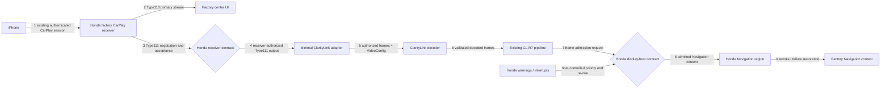
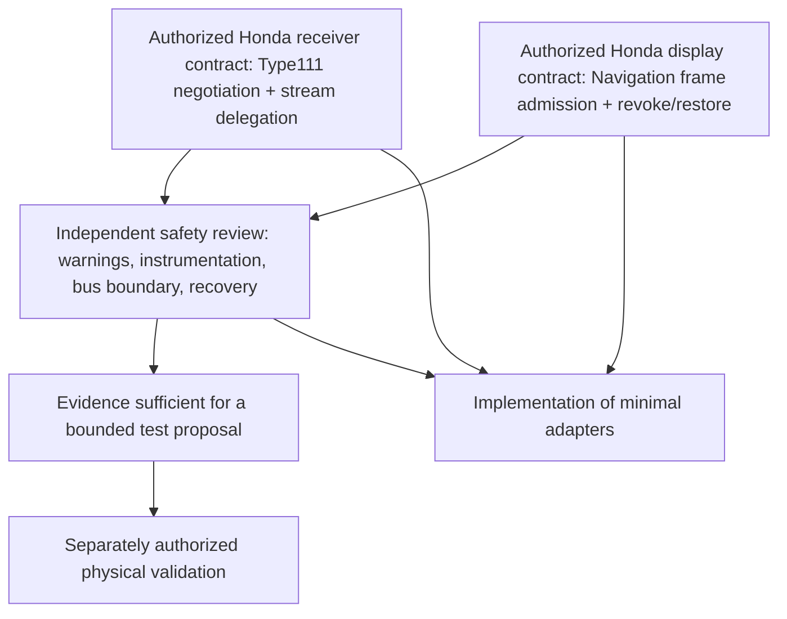

# CL-R10C — Genuine Honda integration architecture decision

**Decision date:** 2026-10-20
**Scope:** 2018 Honda Clarity PHEV Touring, MY16ADA, Android 4.2.2/API 17, ARMv7/Tegra class
**Safety state:** `safeForHonda() == false`. This report authorizes no vehicle, receiver, phone, firmware, display-service, or bus operation.
**Verdict:** **C. NO SUPPORTED HANDOFF FOUND IN EXAMINED EVIDENCE**

## 1. Executive findings

CL-R10A and CL-R10B establish two distinct missing contracts. The receiver evidence does not show the stock Honda receiver advertising, negotiating, or accepting Type111, and does not show a receiver-owned interface that delegates authenticated Type111 frames. The display evidence does not show an authorized, lifecycle-safe frame-admission interface into the Honda-owned Navigation display host. Both gaps must close independently before the laboratory pipeline can become a vehicle integration.

The best architecture, if Honda later documents and authorizes both seams, keeps the factory receiver as the sole owner of the iPhone session and Type110. A receiver-authorized Type111-only output would feed the already validated ClarityLink decoder and CL-R7 pipeline. A separate Honda-owned display-host grant would admit that output into the active Navigation region, with Honda retaining composition, warning priority, revocation, and restoration. Neither proposed seam is established today.

CL-R4 reliability and CL-R7 end-to-end laboratory acceptance remain valid within their API17/emulator and synthetic-fixture scopes. Their Type111-first/Type110-first order handling, decoding, pixels, Binder/PFD transport, warning withdrawal/recovery, process recovery, generation checks, Type110 continuity, and cleanup do not prove Honda negotiation, frame delegation, display ownership, warning priority, or physical cluster output. No new tests can resolve either missing Honda contract without authoritative input.

**No separate physical test is justified now.** A vehicle test cannot make an unsupported receiver SETUP branch or absent display admission contract authorized. Reconsider physical testing only after both contracts are documented for this exact head-unit build, a bounded safety review finds no unresolved ownership/warning/bus issue, and a separate test authorization approves a concrete plan.

## 2. Verified baseline and audit of CL-R10A / CL-R10B

### Repository and publication baseline

At campaign start, this report branch was created from fetched `origin/main` at `91562137448f78bc6a8b890d011b4c5185afea79`. The report worktree was on `feature/cl-r10c-integration-architecture` and initially clean. Remote `refs/heads/main` matched that SHA. The status document on that main snapshot still describes the earlier CL-R4 campaign; its statements are cross-checked with milestone artifacts and the R10A/R10B reports rather than treated as a current campaign pointer.

| Campaign | Verified head | PR state at audit | Checks/review | Decision contribution |
|---|---|---|---|---|
| CL-R10A | `939e4566673bdab03f64d3ec0074c9f03a2732e2` | [#47 open](https://github.com/bmreyes25/ClarityLink/pull/47), base `9156213` | Offline CI and configured CodeQL checks passed; no GitHub review decision at audit | No supported Honda Type111 handoff found |
| CL-R10B | `e2e605cd90d48dfb1d20cbeea7b46f0806e14c4b` | [#48 open](https://github.com/bmreyes25/ClarityLink/pull/48), base `9156213` | Offline CI and configured CodeQL checks passed; no GitHub review decision at audit | Private technical display paths exist, but no supported frame admission |
| CL-R10C | New branch from `91562137448f78bc6a8b890d011b4c5185afea79` | Publication pending this campaign | Documentation-only; no source/tests changed | Combined architecture decision |

Open PRs #40, #43, #44, #45, and #46 were checked and preserved. They cover earlier fail-closed display boundaries, frame-admission evidence, readiness, geometry, and view observability. CL-R10C does not restart or replace CL-R4, CL-R7, CL-HH-02, CL-HH-03, or CL-HH-04A.

### Receiver findings (CL-R10A)

The reviewed MY16ADA build evidence places iAP2/USB and network transport handling, the native CarPlay proxy, and AirPlay receiver session creation/management in the Honda receiver process. The exact association between the iAP2 authentication transition and the AirPlay session is not proved. The receiver builds `/info` from one configured main-screen descriptor. Its examined Control SETUP path handles Type110 and takes the unsupported/default route for Type111. No Honda `extendedFeatures`, `enabledFeatures`, `altScreen`, Type111 Media SETUP, Type111 VideoConfig, stream-to-display identity mapping, authorized frame source, or Type111 teardown contract was found.

The native callback/table evidence is singleton/replacement-oriented; it does not establish a safe additive Type111 registration point. Generic arrays or stream counters do not prove a second configured screen. Historical Type111-first traces with distinct IDs/ports and sustained frames remain parser/trace evidence only. They do not prove that this Honda receiver authenticated, decrypted, accepted, or delegated Type111.

**Exact receiver contract missing:** a Honda-owned, supported interface showing that the authenticated stock session advertises and accepts Type111, supplies authoritative session/stream identity and VideoConfig/transport, authorizes a consumer to receive the stream, and revokes/tears it down without changing Type110 ownership. A service name, reachable function, or synthetic setup model is insufficient.

### Display findings (CL-R10B)

The reviewed Honda external-display host owns Display 1's Android roots and normal content. A preserved display-control Binder surface is control/status only in the examined interface; no arbitrary frame or surface endpoint was found. HondaHack evidence shows private in-process content insertion, not an external supported plugin or admission API. Civic `Clusters` source at `2b9844e4c174df281de99e8e084ae7ee52ad1f61` is a separate platform's private Binder plus overlay precedent; its exact Clarity behavior, bus effects, grants, crash restoration, and warning order are unproven and not portable.

One prior Door Open preemption observation is limited evidence; it does not prove universal warning priority or recovery. Physical Navigation aperture/crop and downstream composition are unknown. Android API 17 display/window capability does not grant ownership of Honda's Navigation region.

**Exact display contract missing:** a Honda-authorized, host-owned frame-admission and revocation API for the active Navigation region, defining caller authorization, viewport, generation/freshness, warning priority, Navigation-page changes, display/host/process death, cleanup, and factory-content restoration, plus its vehicle-bus effect boundary.

## 3. Evidence scope and accepted laboratory baselines

| Claim | Evidence classification | What it proves | What it does not prove |
|---|---|---|---|
| CL-R4 API17 reliability PASS | Accepted laboratory evidence, recorded in repository milestone artifacts | Synthetic/API17 lifecycle, warning, teardown, failure, generation, and recovery acceptance in its stated test scope | Honda receiver negotiation, Honda warning behavior, or cluster output |
| CL-R7 API17 end-to-end PASS | Accepted laboratory evidence, recorded in repository status and run artifacts | Type110-first and Type111-first synthetic flows, H.264 decode and decoded-pixel checks, Binder/PFD delivery, warning preemption/recovery, Type110 continuity, process recovery, generation validation, cleanup | Genuine iPhone/Honda Type111, Honda authentication, or physical display admission |
| Historical Type111-first traffic | Parser/trace observation | The recorded trace had the observed ordering, IDs/ports, and frame activity | Honda-origin authentication, decrypt, acceptance, or delegation |
| Honda Type110 receiver path | Static receiver evidence and historical stock runtime/topology observation | Existing stock primary CarPlay path is owned by factory receiver | That Type111 is enabled or that all iAP2/auth transitions have been mapped |
| Display 1 host ownership | Bounded static evidence and saved read-only display captures | Honda process owns the Android display roots and normal content | Exact physical aperture, safe third-party z-order, warning policy, or bus-free behavior |

Sources: [CL-R10A report at reviewed commit](https://github.com/bmreyes25/ClarityLink/blob/939e4566673bdab03f64d3ec0074c9f03a2732e2/research/native/cl-r10a-type111-receiver-handoff.md), [CL-R10B report at reviewed commit](https://github.com/bmreyes25/ClarityLink/blob/e2e605cd90d48dfb1d20cbeea7b46f0806e14c4b/research/hondahack/cl-r10b-display-ownership.md), [status snapshot](../../docs/status/current.md), [milestone manifest](../../docs/status/milestones.json). Proprietary firmware paths, raw captures, private hook locations, and credentials are intentionally excluded.

## 4. Best candidate end-to-end architecture

The diagram shows the intended design if evidence and authority later exist. It is not a current implementation.

Every arrow is classified below. Classification applies to the arrow's stated scope; where an arrow names a future Honda operation, it is not upgraded by a synthetic downstream PASS.

| # | Arrow / boundary | Classification | Evidence and limit |
|---:|---|---|---|
| 1 | iPhone → factory Honda receiver: existing authenticated primary CarPlay session | **PROVEN** for normal stock CarPlay/Type110 operation; **UNKNOWN** for Type111 authentication association | Stock receiver transport/session path and primary playback are established. The exact iAP2-auth-to-AirPlay-session association and any Type111 session are not. |
| 2 | Honda receiver → factory center UI: Type110 | **PROVEN** within reviewed stock Type110 path | Honda Type110 setup/media path is evidenced. Continued behavior during any future Type111 path still needs proof. |
| 3 | Honda receiver → Type111 negotiation/acceptance | **UNSUPPORTED** in examined Honda build; future enablement **AUTHORIZATION REQUIRED** | `/info` emits one primary descriptor; Control SETUP skips unsupported Type111; no feature agreement found. Trace ordering is not acceptance. |
| 4 | Receiver → authorized Type111 handoff → ClarityLink adapter | **UNSUPPORTED**; receiver authority **AUTHORIZATION REQUIRED** | No additive callback, receiver-owned media API, or stream-specific authorization contract found. The adapter boundary is only proposed. |
| 5 | Adapter → decoder: authorized frames and VideoConfig | **SYNTHETICALLY VALIDATED** for CL-R7 synthetic source/transport; Honda source authorization **UNKNOWN** | Decoder and frame pipeline have accepted fixture streams. Honda frame source, transport metadata, identity, and configuration are absent. |
| 6 | Decoder → existing CL-R7 pipeline | **SYNTHETICALLY VALIDATED** | Accepted API17 laboratory pipeline. No new decode/pipeline work is indicated by current evidence. |
| 7 | CL-R7 output → Honda display-host frame admission request | **SYNTHETICALLY VALIDATED** for the lab output-to-host boundary; actual Honda endpoint **UNSUPPORTED** and **AUTHORIZATION REQUIRED** | The lab validates a synthetic output host. No Honda endpoint accepts frames/surfaces from ClarityLink. |
| 8 | Honda display host → active physical Navigation region | **UNKNOWN** for physical aperture/crop and an external admitted frame; host's Android roots are **PROVEN** | Display 1 host ownership is evidenced. It is not proof of physical region mapping or third-party admission. |
| 9 | Display host → factory Navigation restoration on revoke/failure | **UNKNOWN** as a Honda lifecycle contract; required behavior is specified, not proven | One warning preemption and normal private-hook behavior do not prove revoke, process death, host restart, or stale-frame clearing across cases. |
| W | Honda warnings/interrupts → display composition priority | **PROVEN** only for one prior Door Open observation; general rule **UNKNOWN** | A single observed preemption/return is narrow. No universal warning policy or callback/revocation contract is available. |

### Preferred minimal adapter boundary (proposal only)

If and only if the two Honda contracts arrive, put the stream adapter after receiver-authenticated Type111 setup and before the stream leaves Honda ownership; the display adapter belongs inside or behind the Honda-owned external-display host at Navigation composition. Avoid building a new CarPlay receiver or an independent cluster owner.

The receiver-side grant should bind Honda-issued session identity, stream identity, owner/caller identity, generation, authoritative VideoConfig and transport, frame source, connection-loss notification, revocation, teardown, and Type110 isolation. The display-side grant should bind host-issued display/Navigation identity, caller identity, generation, admitted frame/source type, warning suspension/revocation, stale-frame clearing, host-owned cleanup, and factory restoration. Tokens, callbacks, IDs, format details, bus guarantees, or ownership signals must come from Honda evidence; they must never be fabricated from MHI2/Audi behavior or ClarityLink synthetic fixtures.

## 5. Receiver, display, safety, and validation gates

| Gate | Go condition | Current result | Decision |
|---|---|---|---|
| Receiver | Authorized genuine Type111 advertisement, negotiation, session/stream identity, frame delegation, and teardown are established for the reviewed Honda receiver | **NO-GO** | No supported Type111 dispatch or handoff found |
| Display | Lifecycle-safe Honda frame admission into active Navigation is established with warning preemption and restoration | **NO-GO** | No supported frame endpoint/lease found; private injection is not an admissible interface |
| Safety | Factory instrumentation remains untouched; Honda remains owner of warnings, navigation ownership, and failure restoration; bus effects are bounded | **NO-GO** | Warning generality, physical region, lifecycle restore, and bus boundary are unresolved |
| Validation | Evidence justifies a specifically scoped next physical test | **NO-GO** | A vehicle test cannot substitute for missing authority/contracts; no test plan is justified now |

The gates compose serially: receiver and display contracts are both required before the safety case can be reviewed; only after that may evidence justify a separate test proposal. `safeForHonda()` remains false.

## 6. Critical path and dependency graph

Receiver and display contract acquisition can proceed independently. Adapter implementation, safety approval, and test planning depend on both. CL-R7 does not sit on this critical path as unfinished work; it is an accepted synthetic subsystem.

### Critical-path questions

1. **Can be implemented now:** public-safe documentation, evidence tracking, and fail-closed gate definitions only. No Honda adapter or receiver patch is justified.
2. **Depends on OEM/developer response:** receiver-owned Type111 contract; Clarity display-host frame admission/revocation contract; permission/signing model; warning and recovery semantics; bus-effect statement. An authorized documentation or sample package could supply this evidence.
3. **Additional offline research:** useful only if new accessible source, official interface documentation, or an authorized response appears. Repeating generic display enumeration, decoder tests, or searches of the same reviewed binaries will not resolve either contract.
4. **Separate physical vehicle test:** only after receiver and display gates have passed on paper/source, safety review approves the exact test, and distinct authorization exists. Current evidence does not justify proposing or conducting one.
5. **Do not implement:** Type111 SETUP invention, auth bypass, credential extraction, session/key copying, protected-media interception, callback replacement, Xposed injection, private Binder replay, overlay takeover, navigation/TBT setters, factory binary patching, or speculative vehicle control.
6. **Independent work:** request/receive authorized receiver API documentation; request/receive authorized display-host API documentation; maintain the evidence matrix and ensure public-safe reports. No outreach was sent as part of this campaign.
7. **Smallest useful next development unit:** a bounded evidence acquisition and acceptance checklist for the two contracts, followed by an offline review of any authorized response. No code should be written until a real interface is evidenced.

## 7. Prioritized development backlog

| Priority | Work item | Class | Dependency / exit evidence |
|---|---|---|---|
| P0 | Keep `safeForHonda() == false`; preserve current stock and lab boundaries | Safety blocker | Remains in force until all gates and a separately reviewed authorization change pass |
| P1 | Obtain a supported receiver contract for Type111 advertisement, SETUP, authenticated stream identity/source, and revocation | Authorization blocker / external | Honda/OEM-authorized source, documentation, or API sample for exact receiver build; no inferred fields |
| P1 | Obtain a supported Clarity display-host admission/revoke/restore contract for Navigation content | Authorization blocker / external | Honda-authorized API/sample with caller, region, warning, failure, process-death, restoration, and bus semantics |
| P2 | Independently assess the exact combined design for safety, including warnings, instrumentation ownership, bus effects, and fallback | Safety review | Requires P1 evidence; must conclude factory content returns on all scoped failures |
| P3 | Implement the narrow receiver and display adapters only against verified contracts | Implementation | Requires P1+P2 and a separate approved design; CL-R7 remains the downstream pipeline |
| P4 | Run new offline tests for adapter behavior and fault lifecycle | Validation | Only after real contracts dictate new code/semantics; synthetic tests remain labeled synthetic |
| P5 | Prepare a bounded vehicle validation proposal | Investigation / safety gate | Requires supported APIs, safety approval, test criteria, and separate authorization |
| Optional | Improve matrix provenance/version pinning if new official evidence arrives | Optional documentation | Independent of implementation; no need to duplicate existing R4/R7 testing |

## 8. Evidence and decision matrix

| ID | Assertion / decision | Source/version | Evidence class | Confidence | Remaining uncertainty / gate |
|---|---|---|---|---|---|
| R1 | Native Honda receiver owns observed iAP2/transport and creates/manages AirPlay receiver session | CL-R10A reviewed report, MY16ADA build `1.F1A2.45` basis | Static analysis + bounded topology | High for mapped components | Exact iAP2 auth transition to AirPlay session relationship; Type111 session absent |
| R2 | `/info` builder emits one configured main-screen descriptor | CL-R10A report, receiver audit | Static dataflow | High within examined build/path | Alternate build, hidden capability configuration, opaque feature bits |
| R3 | Type110 setup path exists; Type111 is skipped by examined dispatch | CL-R10A report, Control SETUP comparison | Static control flow | High within examined build/path | Runtime negotiation on variant firmware; no evidence for it now |
| R4 | No additive receiver-owned Type111 callback/API/media sink found | CL-R10A report and bounded callback audit | Negative finding in examined materials | Medium-high | Unexamined OEM interface may exist; needs supported evidence |
| R5 | Historical Type111-first trace contains distinct stream/connection observations | CL-R10A provenance | Parser/trace observation | High for that trace | Does not prove Honda auth, decrypt, acceptance, or delegation |
| D1 | Honda host owns Display 1 Android roots and normal content | CL-R10B bounded review | Static evidence + prior read-only captures | High for Android host ownership | Physical cluster region/crop and external composition |
| D2 | Examined display Binder has no arbitrary frame endpoint | CL-R10B interface review | Static interface analysis | High within examined interface | Other authorized/private interfaces not examined |
| D3 | HondaHack in-process insertion can draw in Honda host | CL-R10B private evidence summary | Technical demonstration | High for that private path | Not third-party API; lifecycle/safety and authority unresolved |
| D4 | One Door Open event preempted and returned | CL-R10B prior Test 4C report | Limited recorded runtime observation | Low-to-medium generality | All warning classes, crash/host recovery, safe z-order |
| D5 | Civic `Clusters` uses private display controls plus overlay | Release `v0.0.2`, commit `2b9844e4c174df281de99e8e084ae7ee52ad1f61` | Third-party source implementation | High for source behavior | Civic-specific; Clarity semantics, bus effects, license/authorization, abnormal recovery unknown |
| L1 | CL-R4 reliability accepted | `docs/status/current.md`, milestones, acceptance record | API17 lab PASS | High for test scope | No Honda runtime claim |
| L2 | CL-R7 end-to-end flow accepted | `docs/status/current.md`, lab record | API17 synthetic lab PASS | High for test scope | No genuine receiver or cluster acceptance |
| A1 | End-to-end Type111 handoff currently supported | Combined R1–D5 | Decision | **No** | Both independent Honda contracts are missing |
| A2 | Physical vehicle test justified now | Combined gates | Decision | **No** | Test would not resolve missing authority/interface, and safety behavior is unresolved |

## 9. Optional physical test plan

**Not proposed.** No separately scoped car test is justified because the exact unanswered questions are interface authority and lifecycle contracts that a vehicle observation cannot establish safely or authoritatively. The missing evidence should first come from an OEM-authorized API/specification or supported sample. No equipment, vehicle operation, or test scope is authorized by this report.

## 10. Review, validation, and publication record

This campaign changes documentation only and adds no executable code. It does not rerun CL-R4/R7 or add synthetic tests, because neither can resolve Honda's missing contracts. `git diff --check` passed after removing Markdown hard-break whitespace; the two status/milestone links resolve in the repository. Separate ECC code/documentation review approved the corrected report; its only comment (two broken relative links) was addressed and rechecked. Separate ECC security/public-safety review approved after removing an account-bearing local path. An independent architecture/safety assessment agreed both Honda gates fail, `safeForHonda()` must remain false, and no physical test is justified. No host tests were run because no executable source changed. PR checks are required and must be reported from GitHub after publication; no R10C CI result is claimed here.

## 11. Final answers and next task

1. **Best candidate architecture:** the stock Honda receiver remains the owner of the existing receiver/Type110 path; only a receiver-authorized Type111 output would enter the existing CL-R7 path; only a separate Honda-host-authorized Navigation frame grant would admit it to the cluster region. Honda retains warning/composition priority, revoke, and restoration. The exact iAP2-authentication-to-AirPlay-session binding is not proven, and both adapter seams are proposed only.
2. **Receiver verdict:** no genuine Honda Type111 negotiation or authorized handoff is established in examined evidence.
3. **Display verdict:** no lifecycle-safe, authorized Honda frame-admission path is established.
4. **Safety verdict:** NO-GO; factory warning priority, physical region, lifecycle restoration, and bus effects are insufficiently specified. `safeForHonda() == false`.
5. **Actual remaining blockers:** the receiver contract; the display host admission contract; independent safety review after those contracts arrive; then separate authorization for any specifically scoped physical validation.
6. **Work completed/tested:** combined evidence audit and architecture/gate decision; no code changed and no new tests run. Existing CL-R4/R7 are accepted laboratory baselines only. PRs #47/#48 CI was verified passing at audit time; R10C checks are pending publication.
7. **Public GitHub state:** R10A #47 and R10B #48 remain open, based on `9156213`, CI passing, no review decision at audit. R10C publication SHA, PR, and CI must be recorded after push.
8. **Next concrete Codex task:** prepare a two-contract evidence request/acceptance checklist (receiver Type111 authority and display-host frame admission) and review any authorized response against it. Do not implement adapter code unless the response proves a supported contract.
9. **Separate physical test:** not justified now and not scheduled or executed.

**Final verdict: C. NO SUPPORTED HANDOFF FOUND IN EXAMINED EVIDENCE.**
